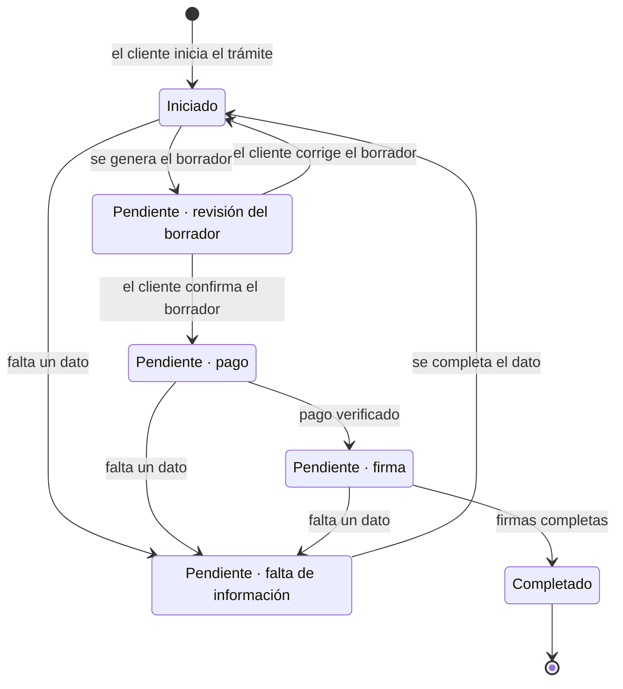

# Ficha funcional del servicio piloto

| | |
|---|---|
| **Cliente** | Easy Office |
| **Proyecto** | CRM Easy Office · Plataforma de gestión y automatización documental |
| **Documento** | FUN-001 · Ficha funcional del servicio piloto |
| **Versión** | 1.2 |
| **Fecha** | 27 de octubre de 2026 |
| **Servicio** | Domicilio tributario |
| **Estado** | Validado parcialmente con Easy Office en la reunión del 08-10-2026 y sus actualizaciones del 12-10-2026 (`ACTA-002`), **sujeto a su confirmación escrita**. Lo marcado `[VALIDAR]` o `[SUPUESTO]` no está confirmado |
| **Preparado por** | Fernando Cartagena · Nicolás Zapata · Marcos Álvarez |

---

## Por qué existe este documento

El §15 de las especificaciones recomienda diseñar y validar el flujo completo de
un servicio piloto antes de desarrollar el resto, y propone el domicilio
tributario. Este documento es ese diseño.

En la versión 1.0 existía además una razón defensiva: los documentos del proyecto
describían el piloto de tres formas distintas.

| Fuente | Qué dice |
|---|---|
| Levantamiento | Contrato por arriendo o cesión del espacio, más una autorización estandarizada. Firma el titular de la oficina |
| Especificaciones §6 | Contrato de domicilio tributario con nombre, RUT, dirección, comuna, servicio contratado y fecha |
| Prototipo | Declaración de cambio de domicilio tributario, firmada por el representante de la empresa |

**Situación tras la reunión del 08-10-2026.** Easy Office confirmó que el
domicilio tributario es el trámite que se automatiza de extremo a extremo,
siguiendo el proceso de las especificaciones (`ACTA-002`, D2-01), y entregó la
plantilla del contrato con la autorización de domicilio (`PLT-01`). La
declaración de cambio de domicilio del prototipo deja de ser la referencia. Las
decisiones que siguen abiertas se listan en el §9.

**Cómo leer las marcas.** *Confirmado* indica lo declarado por Easy Office y cita
su fuente. `[SUPUESTO]` indica lo que el equipo implementó o propuso sin
confirmación. `[VALIDAR]` indica una pregunta abierta.

---

## 1. El servicio

| Elemento | Definición vigente | Estado |
|---|---|---|
| Nombre comercial | Domicilio tributario | Confirmado |
| Qué se vende | El derecho a usar una oficina de Easy Office como domicilio tributario de la empresa del cliente, por un período determinado | `[VALIDAR]` |
| Duración | Dos planes publicados en el sitio web de Easy Office: anual (12 meses) y semestral (6 meses) | `[SUPUESTO]` implementado (RN-44, TA-20) |
| Precio | Los precios incluyen IVA y no existen precios especiales por cliente | Confirmado (RN-44) |
| Valores | Anual 59.990 con firma incluida; semestral 39.990 con firma aparte a 5.000. Ningún precio está confirmado y el anexo de `PLT-01` dice «MÁS I.V.A.» | `[SUPUESTO]` (TA-15, TA-16, TA-20) |
| Renovable | Sí | `[VALIDAR]` (TA-17) |
| Modalidad | Automatizado de extremo a extremo. Hoy el trámite se completa cuando un ejecutivo sube el documento firmado (ver §4) | Confirmado como objetivo (D2-01); la firma automática sigue pendiente |

---

## 2. La oficina contratada

El prototipo original pedía al cliente escribir la dirección y el rol de avalúo.
Eso no tiene sentido si lo que contrata es una oficina de Easy Office: la empresa
conoce esos datos y el cliente no.

**Implementación actual** `[SUPUESTO]`. El cliente **selecciona un inmueble** de
un catálogo administrado por Easy Office. El formulario solo ofrece los inmuebles
que tienen completos los datos del contrato, y deja fuera los de uso exclusivo
que ya están ocupados en la fecha de inicio. La dirección, la comuna y el rol de
avalúo salen del catálogo y se insertan en el documento.

Las tres sucursales (`LF`, `VL`, `SA`) se cargan con dirección y rol de relleno;
los datos reales se ingresan en el panel de administración (`MOD-001`, entidad
`OFICINA`).

Esta forma de elegir la oficina **no tiene una decisión escrita de Easy Office**.

| Pregunta | Estado |
|---|---|
| ¿El cliente elige la oficina o Easy Office se la asigna? | `[VALIDAR]` · implementado como elección del cliente |
| ¿Hay límite de empresas domiciliadas por oficina? | `[VALIDAR]` (`MOD-001` MD-04, `capacidad_domicilios`) |
| ¿El precio depende de la oficina? | `[VALIDAR]` · hoy el precio depende del plan, no de la oficina |
| ¿Hay oficinas en las tres regiones disponibles para autoservicio? | `[VALIDAR]` (TA-19, región de la sucursal de Algarrobo) |

---

## 3. Documentos que se generan

La versión 1.0 planteaba tres opciones sin resolver. Estado actual:

- Easy Office entregó **una plantilla**, `PLT-01`, titulada «Contrato de servicios
  con autorización de domicilio». La plantilla incluye el contrato y la
  autorización de domicilio ante el SII.
- Es la plantilla del trámite piloto y con ella se implementa el flujo (`ACTA-002`,
  CE-04).
- El modelo de datos admite más de un documento por trámite (`TRAMITE` →
  `DOCUMENTO`, `MOD-001`).

La opción C de la versión 1.0 (declaración de cambio de domicilio, la del
prototipo) queda descartada: no coincide con ninguna fuente de Easy Office.

**Pendiente.** No está confirmado si Easy Office quiere emitir el contrato y la
autorización como **un solo documento** o como **dos documentos separados**, cada
uno con sus firmantes. `[VALIDAR]`

---

## 4. Firmantes

**Confirmado** (`ACTA-002`, D2-03 y actualización del 12-10-2026; RN-39). En el
domicilio tributario firman:

| Firmante | Cómo firma |
|---|---|
| El cliente, a través de su representante legal | Firma electrónica avanzada (RN-21) |
| El dueño de la oficina (autorizante) | Firma desasistida |

El autorizante es el **propietario del inmueble**, que puede ser distinto en cada
oficina; por eso se configura por oficina (`ACTA-002`, H2-04).

**Pendiente** `[VALIDAR]`:

- El **orden** de las firmas es un supuesto del equipo.
- RN-39 no menciona al representante de Easy Office como firmante. El script de
  demostración del backend (`seed_demo_firma_avanzada`) firma en este orden:
  representante del cliente, representante de Easy Office, autorizante. Hay que
  confirmar si Easy Office firma en el domicilio tributario.

**Estado de la implementación.**

- **Firma asistida** (por defecto): un ejecutivo sube el PDF firmado y el trámite
  pasa a Completado (RN-24). Esto **no acredita** integración automática con
  tufirma.digital.
- **Firma avanzada en pruebas:** el backend se conecta a un prestador de pruebas
  propio y ficticio, `firma_sandbox/`, sin validez legal.
- **Firma legal:** queda con un prestador acreditado (tufirma.digital) cuando
  lleguen las credenciales (TA-07, en gestión).

**Discrepancia resuelta.** El prototipo mostraba al representante de la empresa
cliente como único firmante pendiente, con Easy Office ya firmado. Se reemplaza
por lo confirmado en RN-39.

---

## 5. Momento del pago

**Confirmado** (`ACTA-002`, D2-09; RN-40). El cliente paga **después de revisar y
aprobar el borrador** del documento.

**Implementado** (PR #51). El cliente revisa el borrador y, al confirmarlo, se crea
la venta del plan; sin esa confirmación no se crea la venta ni se habilita la firma
(RN-13). Esto resuelve la discrepancia de la versión 1.0, donde las especificaciones
§5.1 y §8.1 ponían el pago antes de generar el documento.

**Propuesta del equipo, sin confirmar:** distinguir **vista previa** de
**emisión**. La vista previa sería un documento provisorio, marcado como borrador
sin validez, sin folio y sin envío a firma; la emisión sería el documento
definitivo, con folio y hash, generado tras el pago. `[PROPUESTA – VALIDAR CON EASY OFFICE]`

Hoy el borrador ya recibe su folio al crearse el contrato y es el mismo
documento que se firma (`DEC-001` DE-10). Adoptar esta propuesta exigiría cambiar
esa regla en el código.

**Proveedor de pago.** El equipo integra Klap y Flow detrás de una interfaz común;
Easy Office decide cuál usará (`ACTA-002`, D2-10; TA-08). La política de
reembolsos está abierta (TA-14).

---

## 6. Vigencia y renovación

| Elemento | Definición vigente | Estado |
|---|---|---|
| Inicio de vigencia | Fecha de inicio indicada en el contrato. No puede quedar en el pasado y se admite hasta 30 días a futuro | `[SUPUESTO]` (RN-37, TA-21) |
| Término | Inicio más la duración, **menos un día**. Ejemplo: inicio 02-10-2026 por 12 meses, vence el 01-10-2027 | Confirmado (RN-37, `ACTA-002`) |
| Alertas | 60, 30, 15 y 7 días antes del término | Confirmado, ESP §4.8. **No implementado** (HU-42, HU-53) |
| Renovación | Genera un servicio contratado nuevo y conserva el anterior | `[VALIDAR]` |
| ¿La renovación emite documentos nuevos? | Sí, los mismos del contrato original | `[VALIDAR]` |
| ¿La renovación conserva el folio o genera uno nuevo? | Sin definir | `[VALIDAR]` (TA-17) |
| ¿La renovación es autoservicio o la gestiona un ejecutivo? | Sin definir | `[VALIDAR]` |

El vencimiento se calcula sobre el servicio contratado. La planilla actual lo
digita a mano; la migración lo recalcula con la regla anterior e informa las
diferencias.

---

## 7. Excepciones

Easy Office no ha definido ninguna. La columna de la derecha indica qué hace hoy
el sistema o qué propone el equipo.

| Situación | Pregunta | Comportamiento actual o propuesta |
|---|---|---|
| El cliente detecta un error en el borrador | ¿Puede corregir y regenerar? ¿Cuántas veces? | Sí. Editar el borrador genera una versión nueva del documento con el mismo folio. Sin límite antes del pago `[SUPUESTO]` |
| La fecha de inicio ya pasó al confirmar, pagar o firmar | ¿Qué se hace? | Se pide una fecha nueva y se regenera el documento, porque el contrato y la autorización llevan esa fecha `[SUPUESTO]` (RN-37) |
| El cliente abandona el flujo antes de pagar | ¿Qué pasa con el trámite y con los datos? | **Sin propuesta vigente.** El estado *Abandonado* de la versión 1.0 no existe entre los tres estados confirmados (RN-42) `[VALIDAR]` |
| El pago falla | ¿Se puede reintentar? ¿Cuántas veces? | Sí. Un trámite puede registrar más de un pago (RN-28) y queda Pendiente por pago `[PROPUESTA]` |
| La oficina no está disponible | ¿Se bloquea? | El formulario no ofrece los inmuebles de uso exclusivo ya ocupados y la solicitud se revisa de nuevo para todo su plazo. El límite por oficina sigue abierto (MD-04) |
| El cliente pide un cambio después de pagar y antes de firmar | ¿Se anula y se reemite? ¿Se devuelve el pago? | `[SIN PROPUESTA — requiere decisión de la empresa]` (TA-14) |
| El cliente pide anular después de firmado | ¿Procede? ¿Con qué condiciones? | `[SIN PROPUESTA]` |
| La firma no se completa | ¿Hay plazo? ¿Qué se hace? | El trámite queda Pendiente por firma (RN-24, RN-42). Sin plazo definido `[VALIDAR]` |
| El RUT ya tiene un domicilio tributario vigente con Easy Office | ¿Se permite otro? ¿Se ofrece renovar? | `[SIN PROPUESTA]` |

---

## 8. Flujo

**Confirmado** (`ACTA-002`, actualización del 12-10-2026; RN-42). Un trámite pasa
por tres estados: **Iniciado → Pendiente → Completado**. Mientras está Pendiente,
registra un **motivo**, visible para el ejecutivo en el CRM (RF-47).

El sistema implementa cuatro motivos iniciales: falta de información, revisión del
borrador, pago y firma. La lista definitiva depende de Easy Office (TA-13).
`[VALIDAR]`

El diagrama muestra el camino principal del portal. Las transiciones entre
estados y motivos son un **supuesto del equipo**: viven en una tabla dentro del
código (`TRANSICIONES`) y no están validadas (`MOD-001`, MD-17).

**Qué cambió respecto de la versión 1.0.** El diagrama anterior tenía 15 estados
propios. Easy Office confirmó tres. Las etapas de revisión del borrador, pago y
firma pasan a ser motivos de Pendiente. Los estados *Abandonado, Vigente, Por
vencer, Renovado y Vencido* no forman parte de los estados confirmados del trámite:
el vencimiento y sus alertas pertenecen al servicio contratado (§6) y el
abandono no tiene definición (§7).

---

## 9. Qué falta para cerrar esta ficha

**Cerrado con `ACTA-002`.**

| Pregunta de la versión 1.0 | Respuesta |
|---|---|
| ¿El pago va antes o después del borrador? | Después de revisarlo (D2-09, RN-40) |
| ¿Quién firma? | El cliente y el dueño de la oficina, este con firma desasistida (D2-03, RN-39). Queda abierto el orden y el rol de Easy Office |
| ¿Cómo se calcula el término? | Inicio más duración menos un día (RN-37) |
| ¿Hay precios especiales por cliente? | No, y los precios incluyen IVA (RN-44) |
| ¿Qué estados tiene el trámite? | Iniciado, Pendiente, Completado (RN-42) |

**Sigue abierto**, en orden de impacto. Las cuatro primeras bloquean validar el
piloto.

1. **¿Contrato y autorización se emiten como un solo documento o como dos?** ¿Firma
   Easy Office? ¿En qué orden firman?
2. **¿El cliente selecciona la oficina o se la asignan?** ¿Hay límite de empresas
   por oficina? (MD-04)
3. **¿Se acepta la distinción entre vista previa y emisión?** ¿Cómo se tratan los
   folios en la renovación y en la migración? (TA-03, TA-17)
4. **¿Cuáles son los precios y planes definitivos?** (TA-15, TA-16, TA-20) ¿Cómo
   funciona la renovación?
5. ¿Cuál es la lista cerrada de motivos de Pendiente? (TA-13)
6. ¿Qué ocurre si el cliente pide cambios o anulación después de pagar? ¿Hay
   reembolsos? (TA-14)
7. ¿Qué pasa con un trámite abandonado y con una firma que no se completa?
8. ¿Cuándo llegan las credenciales de tufirma.digital? (TA-07)

---

## Trazabilidad

| Elemento | Referencias |
|---|---|
| Requerimientos | RF-19 a RF-32, RF-47 |
| Historias | HU-23 a HU-29, HU-54 a HU-57, HU-61 |
| Casos de uso | UC-01, UC-15, UC-16, UC-17 |
| Reglas de negocio | RN-13, RN-18, RN-21 a RN-28, RN-37, RN-39, RN-40, RN-42, RN-44 |
| Decisiones de la contraparte | `ACTA-002`: D2-01, D2-03, D2-07, D2-09, D2-10, D2-11 |
| Decisiones del equipo | `DEC-001`: DE-05 firma, DE-07 precio, DE-09 ventana de inicio, DE-10 folio |
| Implementación | Backend PR #51 (domicilio de punta a punta), #60 (motor compartido con la bodega), #68 (firma avanzada con el PSC de pruebas) · Frontend PR #18, #23, #27 |
| Temas abiertos | TA-03, TA-07, TA-08, TA-13 a TA-17, TA-19 a TA-21 (`ACTA-002`, sección 5) |
| Riesgos asociados | R-02 plantillas, R-10 fidelidad de formato, R-11 firma desasistida |

---

## Historial de versiones

| Versión | Fecha | Cambios |
|---|---|---|
| 1.0 | 24-09-2026 | Versión inicial. Registra las tres descripciones divergentes del piloto y propone una definición única para validación |
| 1.1 | 27-10-2026 | Incorpora las decisiones de `ACTA-002` (08 y 12-10-2026): trámite piloto, firmantes (RN-39), pago después del borrador (RN-40), vencimiento (RN-37), estados Iniciado, Pendiente y Completado con motivo (RN-42) y precios con IVA (RN-44). Reemplaza el diagrama de 15 estados por los tres confirmados. Registra el estado de la implementación del backend (oficina, firma asistida y firma de pruebas) distinguiéndolo de lo confirmado. Depura las preguntas abiertas |
| 1.2 | 27-10-2026 | Nota sobre el folio del borrador frente a la propuesta de vista previa y emisión; alertas marcadas como no implementadas; trazabilidad con `DEC-001` y los PR de implementación |
