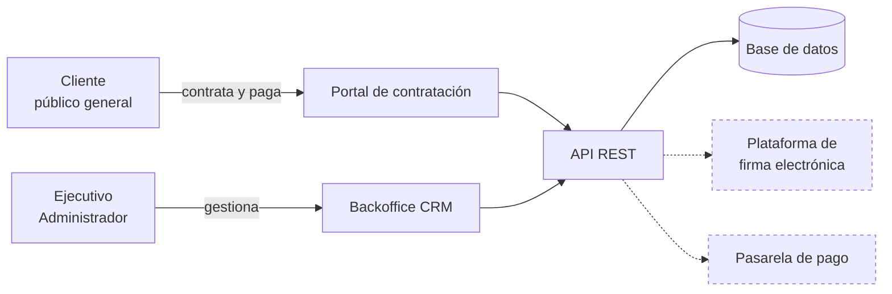
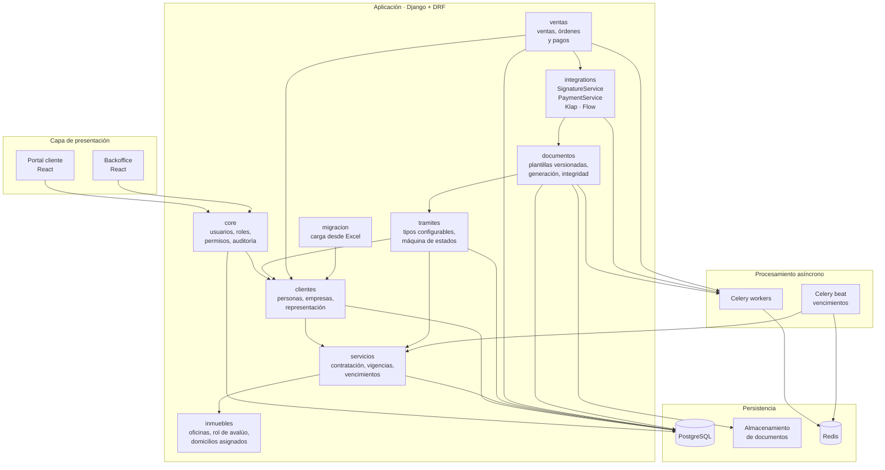
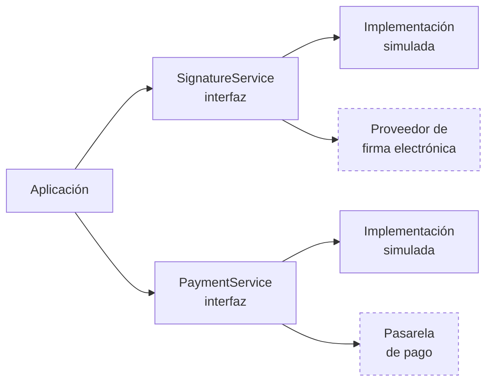
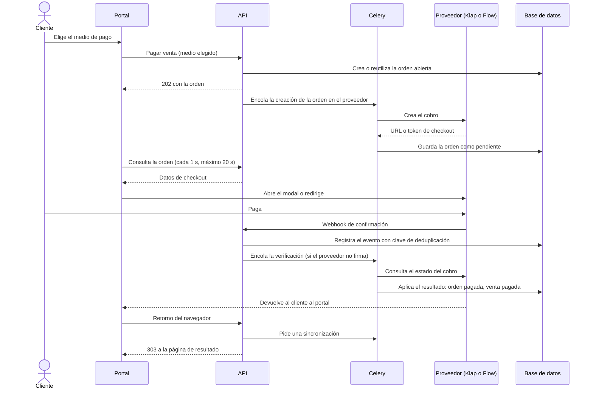
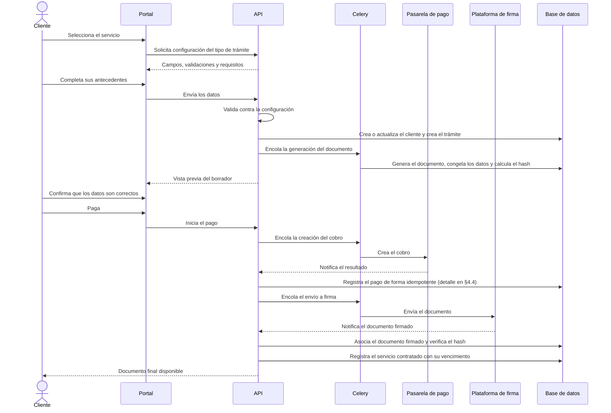
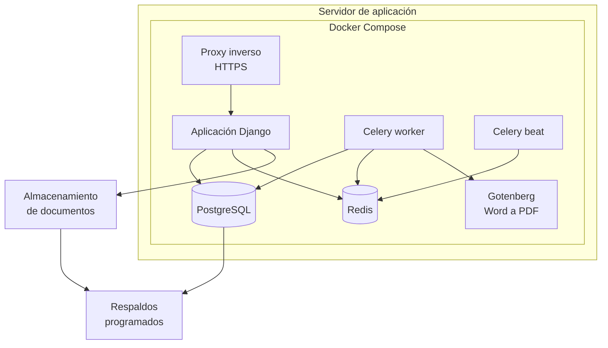

# Arquitectura de la solución

| | |
|---|---|
| **Cliente** | Easy Office |
| **Proyecto** | CRM Easy Office · Plataforma de gestión y automatización documental |
| **Documento** | ARQ-001 · Arquitectura de la solución |
| **Versión** | 1.4 |
| **Fecha** | 17 de octubre de 2026 |
| **Estado** | Propuesta de arquitectura. Sujeta a ajustes al recibir la documentación técnica de la plataforma de firma electrónica |
| **Preparado por** | Fernando Cartagena · Nicolás Zapata · Marcos Álvarez |

---

## 1. Contexto

Easy Office solicita una plataforma compuesta por dos áreas: un CRM interno para
dueños, administradores y ejecutivos, y una web con contratación en línea para
clientes. Ambas comparten la misma información: uno de los requisitos centrales
del encargo es que los datos ingresados por el cliente no se vuelvan a digitar
internamente.

Esa condición determina la primera decisión de arquitectura: **un solo dominio y
una sola base de datos**, con dos interfaces sobre él. No son dos sistemas que se
sincronizan; son dos puertas al mismo sistema.

Las líneas punteadas son servicios de terceros. El sistema no depende de su
disponibilidad para operar internamente.

---

## 2. Estilo arquitectónico

**Monolito modular.** Una aplicación, una base de datos, un despliegue. Por
dentro, módulos con responsabilidades y fronteras explícitas.

**Por qué no microservicios.** Para un equipo de tres personas, un horizonte de
construcción de cinco sprints y un único producto, una arquitectura distribuida agrega complejidad de despliegue,
comunicación entre servicios, observabilidad y mantenimiento que no está
justificada por los requerimientos. El volumen declarado por la contraparte es de
200 a 250 clientes mensuales con una meta de 50 operaciones diarias: no hay
componente que necesite escalar de forma independiente.

Easy Office pidió expresamente (§11) una solución que permita incorporar nuevos
servicios, documentos, roles, sucursales, formas de pago y plataformas de firma.
Esa escalabilidad es **funcional**, no de infraestructura, y se resuelve con
configuración y con módulos bien delimitados, no con despliegues separados.

La modularidad interna deja abierta la posibilidad de extraer un módulo a un
servicio propio más adelante, si alguna vez hiciera falta. El camino inverso, de
microservicios a monolito, es mucho más costoso.

---

## 3. Vista de componentes

### Responsabilidad de cada módulo

| Módulo | Responsabilidad | Puede depender de |
|---|---|---|
| `core` | Usuarios, roles, permisos, registro de auditoría | Nada |
| `clientes` | Personas, empresas, representación legal, ficha del cliente | `core` |
| `servicios` | Servicios contratados, precios, vigencias, alertas de vencimiento | `core`, `clientes` |
| `inmuebles` | Oficinas, rol de avalúo, asignación de domicilios | `core`, `servicios` |
| `tramites` | Tipos de trámite configurables, trámites, máquina de estados | `core`, `clientes`, `servicios` |
| `documentos` | Plantillas versionadas, generación, firmantes, integridad | `core`, `tramites` |
| `ventas` | Catálogo vendible, ventas, órdenes de pago y pagos. Es el único lugar donde cambia el estado de una venta | `core`, `clientes`, `integrations` |
| `integrations` | Interfaces e implementaciones de firma y pago (Klap y Flow) | `core` |
| `migracion` | Carga de la información desde Excel | `clientes`, `servicios` |

**Regla de dependencia.** Los módulos se comunican mediante funciones de servicio
públicas, no consultando directamente los modelos de otro módulo. La dirección de
dependencia es estrictamente descendente en la tabla: `documentos` puede depender
de `tramites`, pero `tramites` nunca de `documentos`. Ningún módulo depende de
`ventas`.

---

## 4. Comunicación entre componentes

### 4.1 Frontend ↔ Backend

API REST sobre HTTPS. Autenticación por **sesión con cookies httpOnly**, no
tokens en almacenamiento del navegador: el sistema maneja datos personales de
clientes reales y una cookie httpOnly no es legible por scripts de la página.

Los dos frontends consumen la misma API. Las diferencias de acceso se resuelven
por permisos del rol, no por endpoints separados. Dentro de la aplicación web, el
personal y los clientes comparten un único mecanismo de sesión.

**Sesión del panel de administración.** El panel de administración de Django
usa su propia cookie de sesión (`sessionid_admin`, y `__Secure-sessionid_admin`
en producción), limitada a la ruta del panel. Las cookies no distinguen el
puerto, así que sin esta separación iniciar sesión en el panel cerraba la sesión
de la aplicación web en el mismo navegador, y viceversa. La cookie `csrftoken`
sigue siendo compartida: un formulario del panel abierto mientras se inicia
sesión en la aplicación web requiere recargar la página.

**Cambio entre sesión de personal y de cliente.** Como la aplicación web usa una
sola sesión, quien abre una pantalla del otro tipo ve un aviso con un único botón
("Ingresar como cliente" o "Ingresar como personal") que cierra la sesión actual
y lleva al ingreso que corresponde, volviendo después a la página donde estaba.
Las pantallas de ingreso y de registro solo redirigen una sesión del mismo tipo;
con una del otro tipo muestran el formulario y avisan que esa sesión se cerrará.
No se separan las sesiones del personal y del cliente, porque exigiría cambiar
el contrato de `/api/auth/me/`.

### 4.2 Procesamiento asíncrono

La generación de documentos y las llamadas a servicios externos no ocurren dentro
del ciclo de una petición HTTP. Se encolan en Celery sobre Redis.

Motivos: generar un documento puede tomar segundos, una llamada a un proveedor
externo puede fallar o demorar, y ambos casos dejarían al usuario esperando o
con un error que no le corresponde.

Celery beat ejecuta además la revisión programada de vencimientos, que alimenta
las alertas configurables de 60, 30, 15 y 7 días que pide el §4.8 del encargo.

### 4.3 Integraciones externas

La aplicación nunca invoca directamente el SDK de un proveedor. Habla con una
interfaz definida por el equipo, y la implementación concreta se selecciona por
configuración del entorno.

Esto responde a dos condiciones del encargo. El §7 subordina la integración de
firma a las capacidades técnicas y la API disponibles, que todavía no están
confirmadas. El §5.3 deja la elección de la pasarela de pago a la recomendación
del equipo, decisión que la empresa aún no toma. Con las interfaces, ninguna de
las dos indefiniciones bloquea el desarrollo.

Los eventos entrantes de ambos proveedores, las notificaciones de resultado de
pago y de firma, se procesan de forma **idempotente**: cada operación externa
lleva un identificador único y se registra un log de eventos recibidos, porque
las notificaciones llegan duplicadas y fuera de orden.

### 4.4 Pagos en línea

El cliente elige entre los medios habilitados por configuración (`PAYMENT_PROVIDERS`).
Cada medio tiene un adaptador detrás de la misma interfaz y una forma de checkout:
**Klap** abre una ventana modal en el portal y **Flow** redirige al sitio del
proveedor.

Reglas del flujo:

- **El precio sale del servidor.** La venta toma el precio del servicio, nunca de
  la petición del cliente.
- **Un solo lugar cambia el estado.** Webhook, retorno del navegador y
  sincronización programada desembocan en la misma operación, que es
  idempotente y solo admite transiciones hacia adelante.
- **El navegador no decide.** La página de resultado espera el estado que
  verificó el backend, no el que informa el modal. El retorno no modifica nada:
  solo pide una sincronización y redirige.
- **Las llamadas externas van en cola**, salvo la validación de Klap, que se
  responde en línea con datos propios (Klap la llama mientras crea la orden y la
  firma recibida aún no se puede verificar: se acepta solo si la referencia
  corresponde a una orden abierta con el mismo monto).
- **Flow envía solo un token sin firma.** Se responde 200 de inmediato y la
  confirmación se verifica en segundo plano consultando a Flow.
- **Sincronización de respaldo.** Si el webhook no llega, una tarea consulta al
  proveedor por el estado de la orden (RF-23).
- **Cambio de medio.** Si el cliente cambia de medio, se cancela la orden abierta
  del anterior y se crea una nueva; las órdenes antiguas expiran.

**Webhook local.** Los proveedores exigen una URL pública para notificar. En
desarrollo local la expone un túnel de Cloudflare que se renueva solo cuando
expira (servicio `tunnel` de Docker Compose). Como deja la API local alcanzable
desde internet mientras corre, en local solo se usan datos ficticios.

---

## 5. Flujo del servicio piloto

Secuencia del domicilio tributario, que Easy Office define como servicio piloto
en el §15.

El último paso es el que conecta el portal con el CRM sin redigitación, que el
§9 identifica como uno de los requisitos centrales del encargo. A partir de ahí
el servicio queda bajo seguimiento y genera sus alertas de vencimiento.

---

## 6. Despliegue

**Conversión a PDF.** El documento se genera en Word desde la plantilla y se
convierte a PDF en un contenedor aparte, Gotenberg (`gotenberg/gotenberg:8.37.0-libreoffice`),
que solo es accesible desde el worker de Celery: no tiene puerto publicado ni ruta
en el proxy. La llamada pasa por una interfaz en `integrations/`, de modo que el
conversor puede cambiarse por configuración (`PDF_CONVERTER`, `GOTENBERG_URL`,
`PDF_CONVERSION_TIMEOUT_SECONDS`).

Toda la configuración se inyecta por variables de entorno. Ninguna credencial
vive en el código ni en el repositorio, que es público.

Los documentos emitidos se almacenan fuera del sistema de archivos efímero del
contenedor. Un volumen de Docker sí persiste entre despliegues, de modo que ese
no es el motivo. Las razones son otras tres: poder respaldar los documentos con
una política distinta a la de la base de datos, poder migrar el sistema a otro
servidor sin arrastrar el almacenamiento, y poder servirlos sin pasar por la
aplicación si el volumen lo justificara. Un volumen dedicado cumple estas
condiciones en la etapa actual; un almacenamiento de objetos compatible con S3 es
la evolución natural si crece el volumen.

El proveedor de alojamiento está `[PENDIENTE DE DEFINIR CON EASY OFFICE]`. Al
estar contenerizado, el despliegue es portable entre proveedores, que es lo que
permite tomar esa decisión más adelante sin rehacer trabajo.

---

## 7. Atributos de calidad y cómo se sostienen

| Atributo | Cómo se aborda | Origen |
|---|---|---|
| Seguridad | Autenticación individual, permisos por rol, secretos en variables de entorno, HTTPS, datos anonimizados en desarrollo | §4.3 del encargo |
| Trazabilidad | Registro de auditoría append-only con usuario, fecha, registro, acción, valor anterior y nuevo | §4.3 |
| Escalabilidad funcional | Servicios, documentos, roles y flujos definidos por configuración, no por código | §11 |
| Escalabilidad de datos | Base relacional con índices sobre los criterios de búsqueda declarados: RUT, razón social, teléfono, correo, folio, servicio | §4.1, §4.5 |
| Disponibilidad | Respaldos periódicos programados de base de datos y documentos | §4.3 |
| Portabilidad | Todo el entorno contenerizado y reproducible con docker-compose | Decisión del equipo: entorno reproducible y portable a cualquier proveedor de alojamiento |
| Mantenibilidad | Módulos con fronteras explícitas, interfaces para dependencias externas | §10 |
| Integridad documental | Hash SHA-256 antes y después de la firma, plantillas versionadas, datos congelados por documento | Decisión del equipo |

---

## 8. Decisiones registradas

| # | Decisión | Alternativa descartada | Motivo |
|---|---|---|---|
| AD-01 | Monolito modular | Microservicios | Equipo de tres, cinco sprints de construcción, un producto, sin necesidad de escalado independiente |
| AD-02 | Una sola base de datos para CRM y portal | Bases separadas con sincronización | El encargo exige que no haya redigitación; sincronizar introduce el problema que se busca eliminar |
| AD-03 | Sesión con cookies httpOnly | JWT en almacenamiento del navegador | Datos personales de clientes reales; el almacenamiento del navegador es legible por scripts |
| AD-04 | Interfaces para firma y pago | Llamadas directas al proveedor | La API de firma no está confirmada y el proveedor de pago no está decidido. Con la interfaz, Klap y Flow quedaron integrados en paralelo y el cliente elige el medio |
| AD-05 | Generación documental y llamadas externas en cola asíncrona | Dentro del ciclo de petición | Latencia y fallas de terceros no deben afectar al usuario |
| AD-06 | Tipos de trámite y servicios definidos por configuración | Desarrollo por cada documento | Lo exigen los §5.2, §8.2, §8.3 y §11 del encargo |
| AD-07 | Almacenamiento de documentos fuera del contenedor | Volumen local del contenedor | Persistencia entre despliegues y respaldo independiente |
| AD-08 | Auditoría mediante disparadores de base de datos | Señales de la aplicación | Ver `DIS-001 §7` |
| AD-09 | El estado de una venta cambia solo en el servicio de dominio de `ventas`, y el precio sale siempre del servidor | Cambiar el estado desde cada endpoint o webhook; aceptar el precio del cliente | Tres caminos (webhook, retorno, sincronización) llegan al mismo resultado y una petición manipulada no debe alterar un cobro |
| AD-10 | Notificaciones de pago idempotentes, con registro de eventos y clave de deduplicación | Procesar cada notificación como nueva | Los proveedores reintentan y notifican fuera de orden |
| AD-11 | Verificar en segundo plano las notificaciones sin firma (Flow) consultando al proveedor | Confiar en el contenido de la notificación | Flow solo envía un token; la verdad la tiene el proveedor |
| AD-12 | Túnel de Cloudflare autorrenovable para recibir webhooks en desarrollo local | URL pública manual por integrante | Los túneles rápidos expiran en uno o dos días y cada integrante necesita una URL viva |
| AD-13 | Llenar la plantilla Word con una librería de plantillas (`docxtpl`), tras convertir una vez los campos de combinación de `PLT-01` a marcas propias | Editar el XML del Word directamente en cada generación | La plantilla queda como configuración editable en Word, no como código por plantilla. Elegida en la prueba técnica del issue #49 |
| AD-14 | Convertir a PDF en un contenedor aparte (Gotenberg, con LibreOffice) | LibreOffice dentro de la imagen del worker; no generar PDF | Vista previa del documento real y PDF para la firma, sin dependencia de Python adicional ni una imagen de aplicación más pesada |
| AD-15 | Cookie de sesión propia para el panel de administración, mediante un middleware que extiende el de sesiones de Django y solo cambia el nombre y la ruta de la cookie | Copiar el código del middleware de Django; mantener una sola sesión | Iniciar sesión en el panel no debe cerrar la sesión de la aplicación web; extender en vez de copiar evita romper con versiones futuras de Django |

---

## 9. Pendientes

- Documentación técnica y API de la plataforma de firma electrónica
  `[PENDIENTE — Easy Office, §14]`
- Decisión de la pasarela de pago: Klap y Flow están integrados y el cliente elige; falta que Easy Office decida cuáles ofrecerá `[PENDIENTE — Easy Office, §5.3]`
- Política de reembolsos: Klap lo soporta en el adaptador, Flow aún no, y la aplicación no expone la operación `[PENDIENTE — Easy Office]`
- Proveedor de alojamiento `[PENDIENTE]`
- Fidelidad del PDF frente al Word original: las plantillas usan Times New Roman y LibreOffice la reemplaza por una fuente de iguales medidas; falta compararlos con Easy Office
- Firma con proveedor: hoy es asistida (un ejecutivo sube el PDF firmado) `[PENDIENTE — credenciales, TA-07]`
- ~~Formato de las plantillas de contratos~~: cerrado el 08-10-2026, son documentos Word con campos de combinación (`13_plantillas`)

---

## Control de cambios

| Versión | Fecha | Descripción | Autor |
|---|---|---|---|
| 1.0 | 24-09-2026 | Emisión inicial | Equipo de proyecto |
| 1.1 | 12-10-2026 | Módulo `ventas`; §4.4 pagos en línea con Klap y Flow; decisiones AD-08 a AD-12; pendientes actualizados | Equipo de proyecto |
| 1.2 | 17-10-2026 | Conversión a PDF con Gotenberg en el despliegue; decisiones AD-13 (docxtpl) y AD-14 (Gotenberg); pendientes de fidelidad del PDF y firma con proveedor | Equipo de proyecto |
| 1.3 | 17-10-2026 | Sesión separada para el panel de administración (§4.1, AD-15; PR #52 del backend) | Equipo de proyecto |
| 1.4 | 17-10-2026 | Cambio entre sesión de personal y de cliente en la aplicación web (§4.1; PR #19 del frontend) | Equipo de proyecto |
