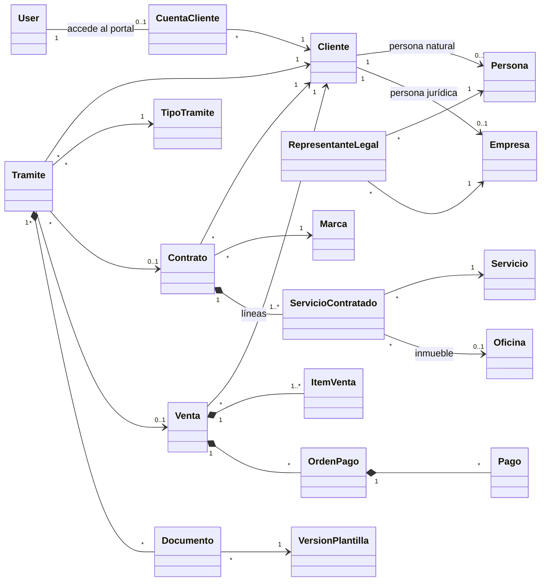
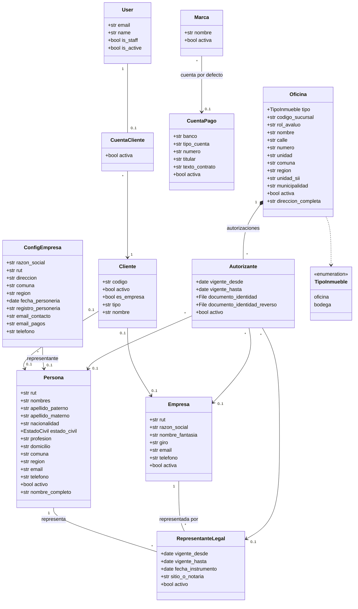
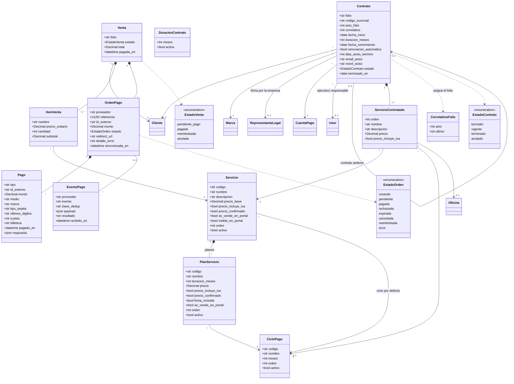
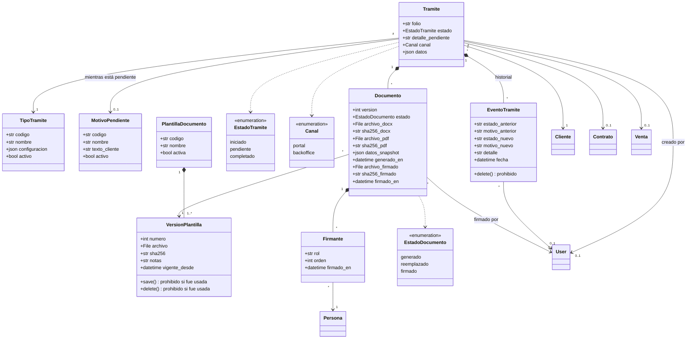
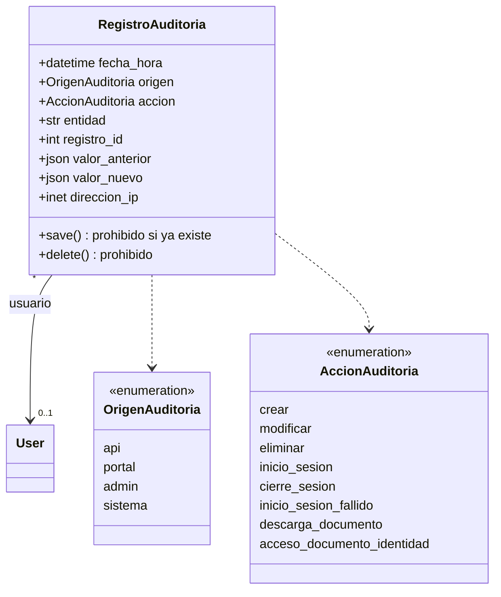
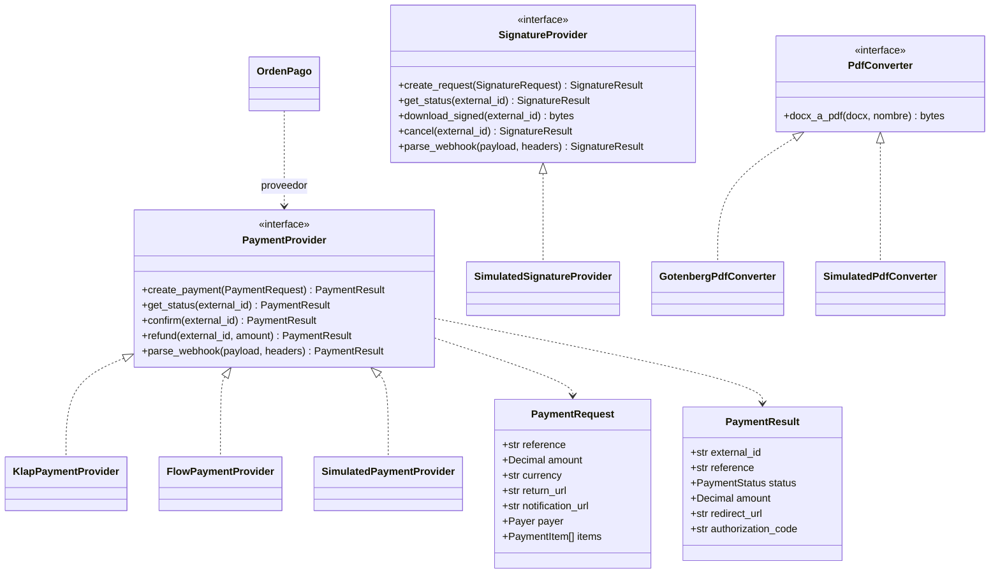

# Diagrama de clases

| | |
|---|---|
| **Cliente** | Easy Office |
| **Proyecto** | CRM Easy Office · Plataforma de gestión y automatización documental |
| **Documento** | UML-002 · Diagrama de clases |
| **Versión** | 1.1 |
| **Fecha** | 22 de octubre de 2026 |
| **Estado** | Refleja el código de la rama principal del backend al 22-10-2026 (después del PR #60) |
| **Preparado por** | Fernando Cartagena · Nicolás Zapata · Marcos Álvarez |

---

## 1. Alcance y notación

Este diagrama muestra las clases **implementadas** en el backend
(`crm_easyoffice/*/models.py` e `integrations/`), no el modelo conceptual. El
modelo conceptual, con las entidades previstas que aún no existen (alertas de
vencimiento, migración), está en `MOD-001`. La auditoría (sección 5 bis) está
en una rama sin fusionar.

- Cada clase es un modelo de Django y una tabla de PostgreSQL. Salvo
  `CorrelativoFolio`, `ServicioContratado`, `Firmante`, `ItemVenta`,
  `EventoPago` y `EventoTramite`, todas heredan de `TimestampedModel`
  (`created_at`, `updated_at`), una clase abstracta del módulo `core`. La
  herencia no se dibuja para no cruzar todos los diagramas con la misma flecha.
- Se muestran los atributos de negocio. Los identificadores (`id`) y las claves
  foráneas se omiten como atributos: aparecen como asociaciones.
- Multiplicidad: `1` obligatorio, `0..1` opcional, `*` varios.
- La lógica de negocio vive en funciones de servicio por módulo
  (`services.py`), no en métodos de los modelos; la sección 7 lista las
  principales.
- Los estados son enumeraciones (`TextChoices` de Django).

---

## 2. Vista general

Las clases agrupadas por módulo y sus asociaciones principales.

---

## 3. Clientes, configuración e inmuebles

**Reglas que el diagrama no alcanza a mostrar**

- Un `Cliente` es persona natural **o** empresa: exactamente uno de los dos
  vínculos está presente.
- `ConfigEmpresa` es un registro único (`unico = true`): los datos de Easy Office
  que imprimen los contratos.
- El autorizante de un inmueble es una persona natural, o una empresa con su
  representante.
- Una bodega solo se ofrece si tiene dirección, rol de avalúo y un autorizante
  vigente con la cédula por ambos lados (`PLT-02`).

---

## 4. Contratos y ventas

**Reglas que el diagrama no alcanza a mostrar**

- El folio del contrato tiene la forma `{sucursal}-{correlativo}-{año}`. El
  correlativo es común a todas las sucursales y marcas y se reinicia cada año
  (`CorrelativoFolio`, uno por año).
- Nombre, descripción, precio e IVA de cada línea se **copian** del catálogo al
  contratar: un cambio posterior del catálogo no altera contratos hechos.
- El plan elegido no se guarda en la línea del contrato: queda en
  `Tramite.datos` y de él salen la duración del contrato y el precio de la venta.
- El estado de una venta solo cambia en `ventas.services.aplicar_resultado`. Las
  notificaciones repetidas de un proveedor se descartan por `clave_dedup`.

---

## 5. Trámites y documentos

**Reglas que el diagrama no alcanza a mostrar**

- `TipoTramite.configuracion` define el servicio por configuración y no por
  código. Claves: `servicio`, `marca`, `plantilla`, `requiere_pago` (booleano o
  lista de canales), `requiere_firma`, `inicio_max_dias`, `planes`,
  `duracion_por_defecto`, `canales`, `tipos_cliente` y `lineas` (cada una con
  `servicio`, `inmueble`, `requisitos`, `inmueble_exclusivo` e
  `incluido_en_plan`). Hay dos tipos cargados: `domicilio-tributario` (`PLT-01`)
  y `bodega` (`PLT-02`).
- El motivo de pendiente (`revision_borrador`, `pago`, `firma`,
  `falta_informacion`) solo existe mientras el trámite está en estado
  `pendiente`.
- `EventoTramite` no se puede eliminar, y una `VersionPlantilla` ya usada no se
  puede modificar ni eliminar: `save()` y `delete()` lanzan un error. Los usuarios
  inician sesión con su correo (`User` no tiene `username`).
- Cada `Documento` guarda la versión de plantilla, una copia congelada de los
  datos con que se generó (`datos_snapshot`) y la huella SHA-256 del Word, del PDF
  y del PDF firmado. Una nueva generación deja la anterior como `reemplazado`.

---

## 5 bis. Auditoría

En la rama `feature/HU-30-auditoria`, sin fusionar al 22-10-2026.

- Las filas las escriben disparadores de PostgreSQL en las tablas auditadas
  (`crear`, `modificar`, `eliminar`) y la función `core.auditoria.registrar_evento`
  para los accesos (ingresos, descargas, cédula). La lista de tablas auditadas
  está en un solo lugar, `core/auditoria/registro.py`.
- `entidad` y `registro_id` identifican el registro afectado sin una clave
  foránea, porque puede pertenecer a cualquier tabla y seguir en el historial
  después de eliminado.
- El usuario se protege (`PROTECT`): quien aparece en el registro no se elimina,
  se desactiva.
- La base rechaza `UPDATE`, `DELETE` y `TRUNCATE` sobre esta tabla.

---

## 6. Interfaces de integración

Las dependencias externas se consumen detrás de una interfaz abstracta con
implementaciones intercambiables por configuración (`AD-04`, `AD-14`).

`SignatureProvider` solo tiene la implementación simulada: la del proveedor de
Easy Office espera sus credenciales (TA-07). Mientras tanto la firma es asistida:
un ejecutivo sube el PDF firmado (`documentos.services.registrar_firmado`).

---

## 7. Principales funciones de servicio

| Módulo | Función | Qué hace |
|---|---|---|
| `tramites` | `iniciar_tramite` | Valida la elección contra `TipoTramite.configuracion`, guarda los datos del contratante, crea el contrato en borrador y el trámite, y pide el documento |
| `tramites` | `confirmar_borrador` | El cliente aprueba el borrador; si el tipo requiere pago, crea la venta |
| `tramites` | `registrar_pago` | Recibe la venta pagada y deja el trámite esperando la firma |
| `tramites` | `completar` | Cierra el trámite y activa el contrato |
| `documentos` | `generar` | Llena la plantilla Word, la convierte a PDF, calcula las huellas y congela los datos |
| `documentos` | `registrar_firmado` | Guarda el PDF firmado con su huella y completa el trámite |
| `contratos` | `crear_contrato`, `activar_contrato` | Asigna el folio, copia las líneas del catálogo y calcula el vencimiento |
| `ventas` | `crear_venta`, `iniciar_pago`, `aplicar_resultado` | Precio desde el servidor, orden de pago en el proveedor y único punto donde cambia el estado de la venta |

Los módulos se avisan por señales para no depender en ambos sentidos: `ventas`
emite `venta_pagada` y `tramites` la escucha; `tramites` emite
`documento_requerido` y `documentos` la escucha. La secuencia completa está en
`ARQ-001 §5`.

---

## 8. Diferencias con el modelo conceptual (`MOD-001`)

| Tema | `MOD-001` | Código |
|---|---|---|
| Auditoría | `REGISTRO_AUDITORIA` | `RegistroAuditoria` en `core`, con el campo `origen` agregado (HU-30, sin fusionar) |
| Alertas de vencimiento | `ALERTA_VENCIMIENTO` | No implementada (HU-42, HU-53) |
| Plan de la línea del contrato | `PLAN_SERVICIO` asociado a `SERVICIO_CONTRATADO` | El plan elegido queda en `Tramite.datos`; la línea no lo referencia |
| Nombre del inmueble | `OFICINA` | La clase se llama `Oficina` y representa oficinas y bodegas (`tipo`) |

---

## Control de cambios

| Versión | Fecha | Descripción | Autor |
|---|---|---|---|
| 1.0 | 22-10-2026 | Emisión inicial, desde el código de la rama principal del backend al 22-10-2026 | Equipo de proyecto |
| 1.1 | 22-10-2026 | Sección 5 bis: `RegistroAuditoria` (HU-30, sin fusionar); §8 actualizada | Equipo de proyecto |
