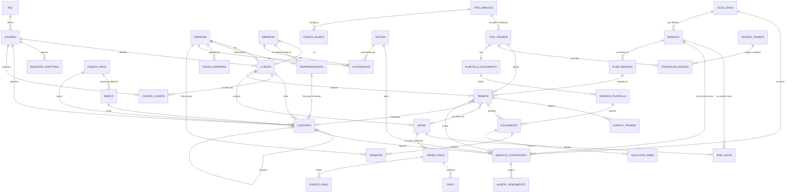

# Modelo de datos

| | |
|---|---|
| **Cliente** | Easy Office |
| **Proyecto** | CRM Easy Office · Plataforma de gestión y automatización documental |
| **Documento** | MOD-001 · Modelo de datos |
| **Versión** | 1.9 |
| **Fecha** | 22 de octubre de 2026 |
| **Motor** | PostgreSQL (ver `REC-001` para la justificación) |
| **Estado** | Actualizado con la muestra de 34 campos, las plantillas y las decisiones de la reunión del 08-10-2026 (`ACTA-002`). Pendientes en la sección 7 |
| **Preparado por** | Fernando Cartagena · Nicolás Zapata · Marcos Álvarez |

---

## 1. Alcance del modelo

Cubre las ocho áreas que define el encargo: usuarios y permisos, ficha del
cliente, servicios contratados con sus vencimientos, oficinas para el servicio
piloto, trámites configurables, documentos con sus plantillas y firmantes, pagos,
y auditoría.

Easy Office estima **alrededor de 30 campos por cliente** entre antecedentes,
contacto, servicios contratados y características de esos servicios (§4.1). El
modelo los distribuye entre `Cliente`, `Persona` y `ServicioContratado` en lugar
de concentrarlos en una sola tabla ancha, porque los datos de servicio son de
cardinalidad múltiple: un cliente puede tener varios servicios (§4.7).

---

## 2. Diagrama entidad-relación

---

## 3. Entidades

### 3.1 Usuarios y permisos

Responde al §4.2 del encargo, que define dos perfiles con facultades distintas y
recomienda un modelo por roles para poder crear perfiles nuevos sin reconstruir
el sistema.

| Entidad | Campos principales | Notas |
|---|---|---|
| `ROL` | `nombre`, `descripcion`, `permisos` | Solo existen dos roles: Administrador y Ejecutivo (`ACTA-002`). El modelo conserva la posibilidad de crear otros como datos (§4.2) |
| `USUARIO` | `email` (identificador de acceso), `nombres`, `apellidos`, `rol`, `activo`, `ultimo_acceso` | Personal de Easy Office. Acceso individual con usuario y contraseña (§4.3) |
| `CUENTA_CLIENTE` | `usuario` (uno a uno con `USUARIO`), `cliente`, `activa` | Cuenta del cliente en el portal (RF-45). Reutiliza la sesión y la contraseña de `USUARIO`, pero **sin rol, sin grupo y sin acceso al backoffice**: los permisos del personal nunca le aplican. Un cliente puede tener más de una cuenta. Al registrarse, un RUT ya existente solo se vincula si el correo coincide y el cliente aún no tiene cuenta; cualquier otro rechazo devuelve el mismo error genérico, para no revelar qué RUT están registrados. **Implementada** |

**Regla derivada del §4.2:** el rol Ejecutivo no tiene la facultad de eliminar
registros de clientes. La restricción se expresa como permiso del rol, no como
condición en el código.

### 3.2 Clientes

| Entidad | Campos principales | Notas |
|---|---|---|
| `CLIENTE` | `codigo` (identificador interno único, por ejemplo `CLI-000042`), `persona` o `empresa` (exactamente uno), `activo` | En el código, los datos de identificación viven en `PERSONA` y `EMPRESA` (RUT, nombre o razón social, giro, correo, teléfono), y `CLIENTE` apunta a uno de los dos. El campo se llamaba `folio`; pasó a `codigo` porque el folio es del contrato (RN-38). La API entrega `codigo` y, durante una versión, `folio` como alias obsoleto. **Implementado** (rama `feature/HU-60-cliente-codigo`, issue #38). Pendientes de modelar: `ejecutivo_responsable`, `estado`, `observaciones` |
| `PERSONA` | `rut`, `nombres`, `apellido_paterno`, `apellido_materno`, `nacionalidad`, `estado_civil`, `profesion`, `domicilio`, `comuna`, `region`, `email`, `telefono` | Personas naturales que intervienen: representantes legales, firmantes, autorizantes, accionistas y arrendadores. Los datos civiles y el domicilio son **opcionales**: al representante del cliente el contrato solo le pide nombre, RUT y domicilio particular con comuna y región; nacionalidad, estado civil y profesión se exigen al representante de Easy Office, al autorizante, a los accionistas y a los arrendadores. `estado_civil` usa las opciones del Registro Civil, incluido el acuerdo de unión civil (Ley 20.830), con etiquetas neutras `[supuesto]`. **Implementado** (rama `feature/HU-08-persona-datos-civiles`, issue #35) |
| `REPRESENTACION` (`RepresentanteLegal` en el código) | `empresa`, `persona`, `fecha_instrumento`, `sitio_o_notaria`, `vigente_desde`, `vigente_hasta` | Un contrato lo firma el representante legal de la empresa, no "el cliente". La vigencia importa: no puede firmar quien ya no representa. `fecha_instrumento` y `sitio_o_notaria` son la **personería** de esa persona para esa empresa: la escritura pública o el estatuto actualizado y el sitio o notaría donde consta (cláusula séptima de `PLT-01`). En versiones anteriores de este documento se llamaban `fecha_escritura_estatuto` y `registro_o_notaria`. **Implementado** (issue #35). Previsto, sin implementar: `cargo` |

`CLIENTE` y `PERSONA` están separadas porque una misma persona puede ser
representante de varias empresas y firmante de documentos donde no es el cliente.
En la planilla, RAZON SOCIAL, R.U.T., GIRO PRINCIPAL, MAIL y CELULAR 8 DIGITOS
alimentan `EMPRESA`; REPRESENTANTE LEGAL, RUT, DOMIC., COMUNA y REGIÓN REP. LEGAL
alimentan `PERSONA`; y FECHA ESCRITURA/ESTATUTO y SITIO/NOTARÍA, `REPRESENTACION`.

### 3.3 Servicios

Responde a los §4.6, §4.7 y §4.8.

| Entidad | Campos principales | Notas |
|---|---|---|
| `TIPO_SERVICIO` | `nombre`, `descripcion`, `precio_base`, `duracion_meses`, `es_automatizable`, `requiere_pago`, `requiere_firma`, `activo` | `es_automatizable` distingue los procesos automatizados de los asistidos |
| `CONTRATO` | `folio` (único), `anio_folio`, `correlativo`, `codigo_sucursal`, `marca`, `cliente`, `representante`, `cuenta_pago`, `fecha_inicio`, `duracion_meses`, `fecha_vencimiento` (calculada), `renovacion_automatica`, `dias_aviso_termino` (30), `correo_aviso`, `celular_aviso`, `ejecutivo_responsable`, `estado` (borrador, vigente, terminado, anulado), `terminado_en`, `contrato_anterior` | Agrupa los servicios contratados en un mismo acto y equivale a una fila de la planilla. Folio según RN-38, con restricción única (año, correlativo); vencimiento según RN-37. Una renovación se registra como contrato nuevo que apunta al anterior `[supuesto]`. El representante puede agregarse después `[supuesto]`. El correo y el celular de aviso se guardan en el contrato `[supuesto: falta confirmar si son de la empresa o del representante]`. La API permite listar, ver y crear, sin editar ni borrar. **Implementado** (rama `feature/HU-60-contrato-folio`, issue #38) El trámite crea el contrato en **borrador** al enviar el formulario, y ahí se asigna el folio: un borrador abandonado o anulado lo conserva, de modo que el correlativo puede tener números sin contrato vigente `[supuesto]`. En borrador, el folio y la sucursal no cambian `[supuesto]`. El contrato pasa a vigente al completarse el trámite (`activar_contrato`). **Borrador implementado** (migración 0004, HU-24 · issue #50 · PR #51) |
| `SERVICIO_CONTRATADO` | `contrato`, `servicio`, `nombre`, `descripcion`, `precio`, `precio_incluye_iva`, `ciclo_pago`, `inmueble` (opcional) | Nombre, descripción, precio e indicador de IVA se **copian** del catálogo al contratar (RN-44): un cambio posterior del catálogo no altera contratos ya hechos, y el precio de lista no se puede cambiar; solo un servicio sin precio fijo recibe el precio acordado. Solo el primer servicio de `PLT-01` tiene ubicación, por eso el inmueble es opcional. Sin límite fijo de tres (TA-12). **Implementado** (issue #38). En `PLT-02` el contrato lleva dos líneas: el domicilio en una sucursal, que encabeza el folio, y la bodega; la línea del domicilio queda incluida en el plan de la bodega y se copia a $0 con el ciclo de ese plan `[supuesto]` (PR #60, fusionado). La línea no guarda el plan: el plan elegido queda en `TRAMITE.datos` (clave `plan`) y de él salen la duración del contrato y el precio de la venta. Previstos para el seguimiento: `fecha_termino`, `estado`, `ejecutivo_responsable`, `caracteristicas` (JSONB) |
| `CICLO_PAGO` | `codigo`, `nombre`, `activo` | Catálogo: único, mensual, trimestral, semestral, anual (formulario de Easy Office). **Implementado** en `ventas` (issue #39) |
| `DURACION_CONTRATO` | `meses`, `activa` | Catálogo: 1, 3, 4, 6 y 12 meses (formulario de Easy Office). **Implementado** (issue #38) |
| `CORRELATIVO_FOLIO` | `anio`, `ultimo` | Un correlativo por año, común a sucursales y marcas. Se bloquea su fila durante la transacción que crea el contrato, para que dos contratos simultáneos no reciban el mismo número ni queden huecos. **Implementado** (issue #38) |
| `CONFIG_ALERTA` | `tipo_servicio`, `dias_anticipacion` | Anticipación configurable. Valores iniciales: 60, 30, 15 y 7 días (§4.8) |
| `ALERTA_VENCIMIENTO` | `servicio_contratado`, `dias_anticipacion`, `fecha_programada`, `estado`, `canal`, `enviada_en` | `canal` queda preparado para correo o mensajería, que el §4.8 menciona como extensión futura |

Las alertas se materializan como filas, no se calculan al vuelo, para que quede
registro de cuáles se generaron y cuáles se gestionaron.

### 3.4 Inmuebles

El servicio piloto es el domicilio tributario, cuyo contrato contiene la
ubicación del inmueble, su rol de avalúo y la autorización de su dueño.

| Entidad | Campos principales | Notas |
|---|---|---|
| `OFICINA` (cualquier inmueble) | `nombre`, `tipo` (oficina / bodega), `codigo_sucursal` (`LF`, `VL`, `SA`), `calle`, `numero`, `unidad`, `comuna`, `region`, `rol_avaluo`, `unidad_sii`, `municipalidad`, `activa` | Representa oficinas y bodegas: en `PLT-02` la bodega es un inmueble con dirección y rol propios. El código de sucursal es único entre las sucursales y queda vacío en las bodegas (restricción en la base de datos); forma parte del folio. `unidad_sii` y `municipalidad` alimentan el texto de la autorización (OB-02) `[supuesto: texto por sucursal]`. Las tres sucursales se cargan con dirección y rol de relleno (`PENDIENTE-LF`, etc.); los datos reales se ingresan en el panel de administración. **Implementado** (rama `feature/HU-66-inmueble-autorizante`, issue #37) Una bodega se ofrece para `PLT-02` si tiene dirección, rol y un autorizante vigente persona natural con RUT, nacionalidad, estado civil, profesión y la cédula por ambos lados en JPG o PNG; el panel de administración indica si está lista para bodega o qué le falta (PR #60, fusionado) |
| `AUTORIZANTE` | `inmueble`, `persona` o `empresa` con su `representante` (exactamente uno, con restricciones en la base de datos), `vigente_desde`, `vigente_hasta`, `documento_identidad` (archivo protegido) | Propietario que autoriza el uso del inmueble (RN-43). En `PLT-01` es una empresa con su representante; en `PLT-02`, una persona natural. Antes se modelaba como tres columnas de `OFICINA`; ahora es una entidad. La cédula de identidad se guarda fuera de los archivos públicos, sin URL, y solo se descarga con un permiso propio que tiene el Administrador (`[supuesto]`: JPG, PNG o PDF de hasta 5 MB). **Implementado** (issue #37) Se agrega `documento_identidad_reverso`, con el mismo almacenamiento privado y las mismas validaciones: `PLT-01` imprime el anverso y el reverso de la cédula (migración 0006). Una sucursal solo se ofrece para el domicilio tributario si tiene todo lo que imprime `PLT-01`: dirección, rol, unidad del SII, municipalidad y un autorizante empresa vigente, con su representante completo y la cédula por ambos lados en JPG o PNG; el panel de administración muestra lo que falta (HU-24 · issue #50 · PR #51) |

**Ocupación del domicilio.** `ASIGNACION_DOMICILIO` se eliminó. Qué empresas
ocupan un inmueble en una fecha se obtiene de los servicios contratados vigentes
que lo tienen como ubicación (`contratos.services.ocupantes`).
`capacidad_domicilios` sigue `[PENDIENTE DE VALIDAR CON EASY OFFICE]` (MD-04).
Para la bodega, `contratos.services.inmuebles_ocupados` considera ocupado un
inmueble mientras un borrador o un contrato vigente se cruza con el período
pedido, pero solo se aplica si la línea del tipo de trámite marca
`inmueble_exclusivo`. Hoy la bodega se trata como compartida `[supuesto: MD-04,
TA-25]` (PR #60, fusionado).

### 3.4 bis Configuración de la empresa

| Entidad | Campos principales | Notas |
|---|---|---|
| `CONFIG_EMPRESA` | `razon_social`, `rut`, `direccion`, `representante` (`PERSONA`), `fecha_personeria`, `registro_personeria`, `correo_contacto`, `correo_pagos`, `telefono` | Datos de Easy Office que aparecen en los contratos. Fila única garantizada por una restricción. Se carga con valores ficticios y sin RUT. **Implementado** en la aplicación `configuracion` (rama `feature/HU-65-config-empresa`, issue #36) |
| `MARCA` | `nombre`, `cuenta_pago_default`, `activa` | EASY OFFICE e INOFFICE, las dos opciones de "EMPRESA" del formulario. Cada una con su cuenta por defecto. `[supuesto: son marcas de la misma empresa]` (`ACTA-002`). **Implementado** (issue #36) |
| `CUENTA_PAGO` | `banco`, `tipo_cuenta`, `numero`, `titular`, `texto_contrato`, `activa` | `texto_contrato` es lo que imprime el contrato (columna BANCO/LINK). Los datos bancarios son opcionales porque BANCO/LINK puede ser un enlace `[supuesto]`. **Implementado** (issue #36) |

Estos datos estaban escritos directamente en las plantillas. Al llevarlos a
configuración, un cambio de representante o de cuenta no obliga a editar cada
plantilla.

### 3.5 Trámites y motor configurable

Responde al §5.2 (formularios que se adaptan a distintos servicios sin desarrollo
nuevo) y al §8.2 (incorporar tipos de documentos de forma modular).

| Entidad | Campos principales | Notas |
|---|---|---|
| `TIPO_TRAMITE` | `nombre`, `tipo_servicio`, `plantilla`, `configuracion` (JSONB: campos, validaciones, orden), `requiere_pago`, `requiere_firma`, `activo`, `version` | El corazón del motor. Un tipo de trámite se define como dato **Implementado** con su configuración en JSONB (HU-24 · issue #50 · PR #51) Segundo tipo, `bodega` ("Bodega virtual", `PLT-02`, migración `tramites/0004`). Claves de `configuracion`, documentadas en el modelo: `servicio`, `marca`, `plantilla`, `requiere_pago` (booleano o lista de canales), `requiere_firma`, `inicio_max_dias`, `planes`, `duracion_por_defecto`, `canales`, `tipos_cliente` y `lineas` (cada una con `servicio`, `inmueble`, `requisitos`, `inmueble_exclusivo` e `incluido_en_plan`). El domicilio queda en el canal portal y la bodega en portal y backoffice (`tramites/0005`). Permiso nuevo `tramites.iniciar_tramite` para Administrador y Ejecutivo (HU-15 · issue #59 · PR #60, fusionado) |
| `ESTADO_TRAMITE` | `codigo`, `nombre`, `es_final` | Valores iniciales según RN-42: Iniciado, Pendiente, Completado **Implementación:** los estados y las transiciones válidas viven hoy en una tabla `TRANSICIONES` dentro del servicio de dominio de `tramites`, no como filas de `ESTADO_TRAMITE` y `TRANSICION_ESTADO` (ver MD-17) |
| `MOTIVO_PENDIENTE` | `codigo`, `nombre`, `aplica_a` (trámite / documento), `activo` | Catálogo de motivos por los que un trámite o documento queda Pendiente (RF-47). Lista inicial propuesta: falta información, revisión del borrador, pago, firma `[PENDIENTE DE VALIDAR CON EASY OFFICE]` **Implementado** con cuatro motivos iniciales: falta de información, revisión del borrador, pago y firma `[supuesto hasta TA-13]` |
| `TRANSICION_ESTADO` | `tipo_tramite`, `estado_origen`, `estado_destino`, `rol_autorizado`, `condicion` | La máquina de estados es una tabla, no condicionales repartidos por el código |
| `TRAMITE` | `folio`, `cliente`, `tipo_tramite`, `servicio_contratado`, `estado_actual`, `motivo_pendiente`, `canal_origen` (portal / backoffice), `ejecutivo`, `datos` (JSONB), `creado_en` | `canal_origen` permite medir cuántos trámites se completan sin intervención de un ejecutivo **Implementado** con folio `TRA-000001`. El motivo solo existe mientras el trámite está Pendiente. Enlaza el contrato y la venta (MD-10). Si falta un dato para generar el documento, el trámite queda Pendiente por falta de información, con el motivo visible para el ejecutivo |
| `EVENTO_TRAMITE` | `tramite`, `estado_anterior`, `estado_nuevo`, `usuario`, `fecha`, `observacion` | Línea de tiempo del trámite **Implementado**, solo inserción |

La `configuracion` en JSONB guarda la definición del formulario. PostgreSQL
permite indexar y consultar dentro de ese campo, de modo que no se pierde
capacidad de consulta al usarlo.

### 3.6 Documentos

| Entidad | Campos principales | Notas |
|---|---|---|
| `PLANTILLA_DOCUMENTO` | `nombre`, `tipo_documento`, `activa` | Easy Office ya tiene formatos definidos (§6) **Implementado** |
| `VERSION_PLANTILLA` | `plantilla`, `numero_version`, `archivo`, `campos_requeridos` (JSONB), `vigente_desde`, `creada_por` | Inmutable una vez emitido un documento con ella **Implementado.** La migración carga `PLT-01` versión 1, convertida una vez a plantilla con marcas propias desde el Word anonimizado (`manage.py convertir_plt01`) `PLT-02` versión 1 se carga igual desde el archivo anonimizado de `13_plantillas`, idéntico byte a byte, con los marcadores `«BODEGA_*»` (migración `documentos/0003`). El comando pasa a ser `convertir_plantilla`, para `PLT-01` o `PLT-02`, y `convertir_plt01` queda como alias (PR #60, fusionado) |
| `DOCUMENTO` | `tramite`, `version_plantilla`, `archivo_generado`, `hash_generado`, `archivo_firmado`, `hash_firmado`, `datos_snapshot` (JSONB), `estado`, `generado_en` | Un trámite puede producir más de un documento: por ejemplo contrato y autorización, o una regeneración tras corregir datos. Ver decisiones 1 a 3 **Implementado:** guarda el Word y el PDF generados, cada uno con su SHA-256, la copia congelada de los datos y el PDF firmado con su propio SHA-256. Editar el borrador genera una versión nueva del documento con el mismo folio |
| `FIRMANTE` | `documento`, `persona`, `rol_firmante`, `orden`, `estado`, `firmado_en` | Un documento puede requerir más de una firma **Implementado** según RN-39 `[supuesto: orden de firmas]` |
| `SOLICITUD_FIRMA` | `documento`, `proveedor`, `id_externo`, `estado`, `enviada_en`, `respuesta` (JSONB) | `id_externo` único para idempotencia No implementado: hoy la firma es asistida (un ejecutivo sube el PDF firmado) |

### 3.7 Ventas y pagos

Implementado en el módulo `ventas` (ver `ARQ-001 §4.4`). Una **venta** es lo que el
cliente compra; una **orden de pago** es un intento de cobrarla ante un proveedor;
un **pago** es la transacción que el proveedor confirmó. Separarlos permite
reintentar con otro medio sin duplicar la venta (RN-28).

| Entidad | Campos principales | Notas |
|---|---|---|
| `SERVICIO` | `codigo` (único), `nombre`, `descripcion`, `precio_base` (CLP, puede ir vacío), `precio_incluye_iva`, `ciclo_pago_default`, `se_vende_en_portal`, `visible_en_portal`, `orden`, `precio_confirmado`, `activo` | Catálogo vendible, editable desde el panel de administración. Cargado desde el formulario de Easy Office con sus descripciones textuales: Domicilio tributario 59.990 anual (se vende en el portal), Creación de empresas 49.990 único y Web mail + dominio 14.990 anual (fuera del portal), y Contabilidad inactiva, sin precio ni descripción. La restricción `servicio_portal_con_precio` impide un servicio del portal sin precio. `precio_confirmado` sigue falso en todos mientras no se resuelva el IVA (RN-44). **Implementado** (rama `feature/HU-23-catalogo-servicios`, issue #39) Dos marcas independientes: `visible_en_portal` pone la tarjeta en la landing y `se_vende_en_portal` permite contratarlo en línea (exige precio). La firma electrónica avanzada es contratable pero no visible: se cobra dentro del domicilio tributario. Bodega, arriendo de vehículo, arriendo de estacionamiento, acuerdo de accionistas y poder simple son visibles, no contratables y sin precio, con descripciones propias `[supuesto]`. `orden` fija el orden de las tarjetas (PR #48) La bodega pasa a venderse en el portal, con precio base 59.990 y ciclo anual si aún no tenía precio (`ventas/0013`, PR #60, fusionado) `[supuesto: TA-15]` |
| `PLAN_SERVICIO` | `servicio`, `codigo`, `nombre`, `duracion`, `ciclo_pago`, `precio`, `precio_incluye_iva`, `precio_confirmado`, `firma_incluida`, `se_vende_en_portal`, `orden`, `activo` | Lo que el cliente elige al contratar en línea: el precio depende del plazo. Carga inicial según el sitio web de Easy Office: plan anual, 12 meses, 59.990, firma electrónica incluida; y plan semestral, 6 meses, 39.990, con la firma aparte. La firma electrónica avanzada del catálogo pasa de 3.500 a 5.000 `[supuesto: planes, precios y firma pendientes de confirmar, IVA incluido]`. **Implementado** (migraciones 0011 y 0012, HU-24 · issue #50 · PR #51) Bodega virtual: planes anual (12 meses), semestral (6) y trimestral (3), los tres a 59.990 con la firma incluida y `precio_confirmado` falso, mientras se reciben los precios reales. La migración solo agrega lo que falta y conserva lo editado en el panel de administración (`ventas/0013`, PR #60, fusionado) `[supuesto: TA-15, TA-26]` |
| `VENTA` | `folio` (VEN-000001), `cliente`, `estado`, `total`, `pagada_en` | Estados: pendiente de pago, pagada, reembolsada, anulada. Su estado solo cambia mediante el servicio de dominio de `ventas`, nunca por escritura directa |
| `ITEM_VENTA` | `venta`, `servicio`, `nombre`, `precio_unitario`, `cantidad`, `subtotal` | Nombre y precio se **copian al comprar** (RN-08): un cambio posterior del catálogo no altera ventas ya hechas. El precio sale siempre del servidor, nunca de la petición del cliente |
| `ORDEN_PAGO` | `venta`, `proveedor`, `referencia` (UUID único, es lo que ve el proveedor), `id_externo` (único, nulo hasta que el proveedor responde), `monto`, `estado`, `redirect_url`, `detalle_error`, `sincronizada_en` | Un intento de cobro (RN-28). Estados: creando, pendiente, pagada, rechazada, expirada, cancelada, reembolsada, error. Solo hay transiciones hacia adelante; el dinero recibido prevalece sobre un rechazo anterior y un monto distinto del esperado deja la orden en error |
| `PAGO` | `orden`, `tipo`, `id_externo` (con índice, no único), `monto`, `medio`, `marca`, `tipo_tarjeta`, `ultimos_digitos`, `cuotas`, `billetera`, `pagado_en`, `respuesta` (JSONB) | Transacción confirmada. Restricción: un solo pago de tipo venta por orden. `id_externo` no es único porque el ambiente de pruebas de Klap repite el mismo identificador de comercio en todos los pagos |
| `EVENTO_PAGO` | `orden`, `proveedor`, `evento`, `clave_dedup` (único), `payload` (JSONB), `resultado` | Registro de notificaciones, solo inserción. Resultado: procesado, ignorado, firma inválida o rechazado. `clave_dedup` hace idempotente la recepción: una notificación repetida recibe la misma respuesta que la primera |

**Vínculo con el trámite.** Hoy la venta se asocia al cliente, pero todavía no al
trámite ni al contrato, ni tiene ejecutivo responsable. Ese vínculo es parte del
flujo de punta a punta del domicilio tributario (MD-10); mientras tanto, las
ventas del dashboard se muestran como datos de ejemplo. La modalidad 50/50 que
Easy Office usa hoy por transferencia no está modelada.

### 3.8 Auditoría

Responde literalmente al §4.3, que enumera los campos que debe registrar cada
modificación importante.

| Entidad | Campos principales |
|---|---|
| `REGISTRO_AUDITORIA` | `usuario`, `accion`, `entidad`, `registro_id`, `valor_anterior` (JSONB), `valor_nuevo` (JSONB), `fecha_hora`, `direccion_ip` |

El encargo exige que el historial esté protegido para impedir que usuarios
normales lo alteren o eliminen. Se implementa como tabla **append-only**: sin
operaciones de actualización ni borrado, y con la escritura mediante disparadores
de base de datos en lugar de señales de la aplicación, porque un disparador es
más difícil de eludir y más fácil de demostrar ante una auditoría.

---

## 4. Decisiones de diseño

**1 · Plantillas versionadas.** Cada documento emitido apunta a la versión exacta
de plantilla con que se generó. Si Easy Office corrige una cláusula, los
documentos emitidos antes no cambian. Sin esto, un contrato firmado en marzo
podría "reescribirse" al editar la plantilla en mayo.

**2 · Copia congelada de los datos.** `DOCUMENTO.datos_snapshot` guarda los datos
usados al generar. Si el cliente actualiza su dirección después, el contrato
firmado conserva la que tenía al firmar. Es la diferencia entre un sistema
documental y un generador de plantillas.

**3 · Hash de integridad.** Se calcula y almacena por separado para el archivo
generado y para el archivo firmado.

Importante: **los dos hashes son necesariamente distintos**. La firma electrónica
se incorpora dentro del PDF, que admite actualizaciones incrementales, de modo
que el archivo firmado no es byte a byte igual al generado. Comparar ambos hashes
esperando igualdad sería un control que falla siempre.

Lo que cada hash permite verificar:

- `hash_generado` prueba qué archivo exacto se envió al proveedor de firma, y
  permite detectar cualquier alteración del documento entre su generación y su
  envío.
- `hash_firmado` prueba qué archivo exacto se recibió de vuelta, y permite
  detectar alteraciones posteriores al archivo almacenado.
- La correspondencia entre ambos se establece por el identificador de la
  solicitud de firma (`SOLICITUD_FIRMA.id_externo`), no por comparación de
  hashes, y se complementa con la validación de la firma del documento recibido.

**4 · Máquina de estados como datos.** Las transiciones válidas viven en
`TRANSICION_ESTADO`, con el rol autorizado para cada una. Agregar un estado a un
servicio nuevo no requiere tocar código. La primera implementación las define en
una tabla dentro del código de `tramites` (MD-17).

**5 · Idempotencia en operaciones externas.** `EVENTO_PAGO` lleva una clave de
deduplicación única y `SOLICITUD_FIRMA` un identificador externo único; ambos
registran cada evento recibido.

**6 · JSONB donde la forma es variable.** `TIPO_TRAMITE.configuracion`,
`TRAMITE.datos`, `SERVICIO_CONTRATADO.caracteristicas` y los valores de auditoría.
El resto es relacional estricto, con claves foráneas e integridad referencial.

**7 · Trámite y servicio contratado son distintos.** El trámite es la operación,
con su flujo y sus estados; el servicio contratado es lo que el cliente tiene
vigente, con su fecha de vencimiento. Un trámite de renovación crea un servicio
contratado nuevo sin borrar el anterior, lo que preserva el historial que pide
el §4.6.

**8 · El folio pertenece al contrato.** La planilla de Easy Office genera un folio
nuevo en cada ingreso y el contrato se titula con él, de modo que el folio
identifica el contrato y no al cliente. Un cliente que renueva o contrata otro
servicio conserva su registro y recibe un contrato con folio nuevo. El
correlativo se asigna dentro de una transacción con bloqueo para que dos
contratos simultáneos no reciban el mismo número.

**9 · Tablas para lo que se reutiliza, JSONB para lo propio de cada documento.**
Personas, empresas, representaciones, inmuebles y contratos van en tablas porque
se buscan y se reutilizan entre documentos. Lo propio de un documento (el
vehículo de un arriendo, la inscripción en el Conservador, la renta, las
modificaciones de estatutos) va en `TRAMITE.datos`, según la configuración de su
tipo de trámite. Así, agregar un documento no exige crear tablas.

**10 · Documentos de identidad fuera del almacenamiento público.** La cédula del
autorizante se guarda en un almacenamiento privado, separado de los archivos
públicos y sin URL, y se descarga por un servicio protegido con un permiso propio.
Retención y cifrado en reposo quedan pendientes (MD-13).

---

## 5. Índices previstos

Derivados de los criterios de búsqueda del §4.5 y de los indicadores del §4.9.

| Tabla | Índice | Motivo |
|---|---|---|
| `CLIENTE` | `rut` (único), `codigo` (único) | Identificación |
| `CONTRATO` | `folio` (único), (`anio_folio`, `correlativo`) (único), `fecha_vencimiento` | Búsqueda por folio, unicidad del correlativo y vencimientos |
| `OFICINA` | `codigo_sucursal` (único entre sucursales) | Código del folio |
| `CLIENTE` | `nombre_razon_social`, `email`, `telefono` | Búsqueda declarada |
| `CLIENTE` | `ejecutivo_responsable`, `estado` | Filtros del listado |
| `SERVICIO_CONTRATADO` | `fecha_termino`, `estado` | Detección de vencimientos |
| `SERVICIO_CONTRATADO` | `tipo_servicio`, `ejecutivo_responsable` | Ventas por servicio y por ejecutivo |
| `TRAMITE` | `folio` (único), `estado_actual`, `creado_en` | Listados y dashboard |
| `REGISTRO_AUDITORIA` | `entidad` + `registro_id`, `fecha_hora` | Consulta del historial de un registro |

---

## 6. Migración desde Excel

Easy Office entregó el formulario de Excel con macros y una muestra de la base
de datos con 34 columnas (`ACTA-002`). Cada fila de la planilla corresponde a un
contrato y se distribuye así: `CONTRATO` (folio, fechas, duración, sucursal,
cuenta), hasta tres `SERVICIO_CONTRATADO` (servicio, precio, ciclo), `CLIENTE`
(razón social, RUT, giro, correo, celular), `PERSONA` y `REPRESENTACION`
(representante legal, su domicilio y la fecha de la personería). El diccionario
completo está en `13_plantillas/README.md`.

Dos reglas propias de la migración:

- El vencimiento se **recalcula** con RN-37 y las diferencias con el valor
  digitado se informan en el reporte, sin corregirlas en silencio.
- Los folios históricos se conservan tal como están, aunque usen el formato
  anterior de dos dígitos `[PENDIENTE DE VALIDAR CON EASY OFFICE]`.

El proceso previsto:

1. **Perfilado.** Inventario de columnas, tipos reales, valores nulos, duplicados
   y formatos inconsistentes.
2. **Mapeo.** Tabla de correspondencia entre cada columna y su campo destino, con
   las transformaciones necesarias.
3. **Carga en etapas.** Tabla de staging sin restricciones, validación, y recién
   entonces carga a las tablas definitivas.
4. **Cuarentena.** Los registros que no pasan validación no se cargan a medias:
   quedan apartados con el motivo.
5. **Reporte.** Salida con registros cargados, en cuarentena y el motivo de cada
   rechazo, para que Easy Office corrija en origen.
6. **Repetible.** El proceso puede ejecutarse varias veces sin duplicar registros.

La planilla contiene datos personales reales. Se anonimiza antes de entrar a
cualquier entorno de desarrollo y ningún dato real se versiona en el repositorio,
que es público.

---

## 7. Pendientes de validación

| # | Pendiente | Impacto |
|---|---|---|
| MD-01 | ~~Listado definitivo de los campos del cliente~~ | Cerrado: muestra de 34 campos recibida el 08-10-2026 |
| MD-02 | Listado de servicios y sus características | Define `TIPO_SERVICIO` y el contenido de `caracteristicas` |
| MD-03 | Motivos de pendiente y transiciones válidas | Estados confirmados el 12-10-2026 (Iniciado, Pendiente, Completado); falta la lista cerrada de motivos (TA-13) |
| MD-04 | Si existe límite de empresas domiciliadas por oficina, y si una bodega la usa un solo cliente (TA-25) | Define `capacidad_domicilios` y si la bodega activa `inmueble_exclusivo` |
| MD-05 | ~~Formato de las plantillas de contrato~~ | Cerrado: Word con campos de combinación (`13_plantillas`) |
| MD-06 | Si los precios son fijos por servicio o varían por cliente | Ya está previsto guardarlos en la contratación |
| MD-07 | Campos variables de cada documento a automatizar | Definidos para PLT-01 y PLT-02; pendientes PLT-03 a PLT-05 y el poder simple |
| MD-08 | ~~Regla exacta del vencimiento~~ | Cerrado 12-10-2026: inicio + duración − 1 día (RN-37) |
| MD-09 | Tratamiento de los folios históricos de dos dígitos (TA-03) | El formato vigente es de cuatro dígitos; el ancho es configurable (`CONTRATO_FOLIO_ANCHO`) para poder conservar los históricos |
| MD-10 | ~~Vínculo de `VENTA` con `TRAMITE` y `CONTRATO`~~ | Cerrado en el código (PR #51): el trámite enlaza contrato y venta. Siguen abiertos el ejecutivo de la venta y la relación entre `SERVICIO` y `TIPO_SERVICIO` |
| MD-11 | Política de reembolsos | El adaptador de Klap soporta el reembolso; el de Flow no, y no existe operación de reembolso en la aplicación |
| MD-12 | Precios definitivos e IVA | Precios cargados desde el formulario de Easy Office; queda resolver si incluyen IVA (RN-44 frente al anexo de `PLT-01`, que dice «MÁS I.V.A.») y la lista vigente (TA-15) Precios por plan cargados desde el sitio web; precio de la firma: 3.500 (carga anterior), 5.900 (anexo) o 5.000 (sitio web) |
| MD-13 | Retención y cifrado en reposo de la cédula del autorizante | Ley 21.719 de protección de datos personales; depende del alojamiento (TA-09) Incluye la conservación de los borradores de contrato abandonados |
| MD-14 | Si la renovación conserva el folio | Hoy una renovación es un contrato nuevo con folio nuevo que apunta al anterior |
| MD-15 | Dueño del correo y del celular de aviso (empresa o representante) | Define dónde se guardan; hoy viven en `CONTRATO` |
| MD-16 | Registro en auditoría de los modelos nuevos (RF-15) | Contratos, inmuebles, autorizantes y configuración aún no quedan en el registro de auditoría |
| MD-17 | Transiciones de estado en el código frente a la tabla `TRANSICION_ESTADO` | La decisión 4 y el `CLAUDE.md` prevén una tabla de datos; la primera implementación usa una tabla en el código |

---

## Historial de versiones

| Versión | Fecha | Cambios |
|---|---|---|
| 1.0 | 24-09-2026 | Modelo inicial |
| 1.1 | 09-10-2026 | Entidades `CONTRATO`, `CUENTA_CLIENTE`, `CONFIG_EMPRESA` y `CUENTA_PAGO`; el folio pasa del cliente al contrato; atributos de oficina (código, autorizante, unidad del SII) y de persona requeridos por los contratos; estados iniciales; mapeo de la planilla de 34 columnas; pendientes MD-01 y MD-05 cerrados |
| 1.2 | 12-10-2026 | Estados Iniciado, Pendiente y Completado; catálogo `MOTIVO_PENDIENTE` y campo `TRAMITE.motivo_pendiente` (RF-47); MD-08 cerrado |
| 1.3 | 12-10-2026 | Modelo implementado de cuentas de cliente (`CUENTA_CLIENTE` ligada a `USUARIO`) y de ventas y pagos (`SERVICIO`, `VENTA`, `ITEM_VENTA`, `ORDEN_PAGO`, `PAGO`, `EVENTO_PAGO`); pendientes MD-10 a MD-12 |
| 1.4 | 14-10-2026 | Modelo implementado (issues #35 a #39; PR #40 a #45): datos civiles de `PERSONA` y personería en `REPRESENTACION` con sus nombres reales; `CLIENTE.folio` pasa a `codigo`; inmuebles con tipo y código de sucursal; `AUTORIZANTE` como entidad; `ASIGNACION_DOMICILIO` eliminada; `CONFIG_EMPRESA`, `MARCA` y `CUENTA_PAGO`; `CONTRATO`, `SERVICIO_CONTRATADO`, `DURACION_CONTRATO`, `CORRELATIVO_FOLIO` y `CICLO_PAGO`; catálogo de servicios del formulario; decisiones 9 y 10; pendientes MD-13 a MD-16 |
| 1.5 | 17-10-2026 | Domicilio tributario de punta a punta (issue #50, PR #51, sin fusionar): `PLAN_SERVICIO`; contrato en borrador; `plan` en `SERVICIO_CONTRATADO`; reverso de la cédula del autorizante; `TIPO_TRAMITE`, `MOTIVO_PENDIENTE`, `TRAMITE`, `EVENTO_TRAMITE`, `PLANTILLA_DOCUMENTO`, `VERSION_PLANTILLA`, `DOCUMENTO` y `FIRMANTE` implementados; MD-10 cerrado en el código; nuevo MD-17 |
| 1.6 | 17-10-2026 | PR #51 del backend y PR #18 del frontend fusionados: lo marcado como implementado en la versión 1.5 ya está en la rama principal |
| 1.7 | 20-10-2026 | `SERVICIO` con `visible_en_portal` y `orden` (PR #48) |
| 1.8 | 21-10-2026 | Bodega virtual con `PLT-02` (issue #59, PR #60, abierto): tipo de trámite `bodega` y claves de `configuracion`; permiso `tramites.iniciar_tramite`; planes de la bodega; línea del domicilio incluida en el plan; requisitos de la bodega; ocupación de inmuebles exclusivos; `PLT-02` v1; MD-04 ampliado |
| 1.9 | 22-10-2026 | PR #60 del backend y PR #23 del frontend fusionados: lo descrito de la bodega virtual en la versión 1.8 ya está en la rama principal. Diagrama de clases en `UML-002`. Corrección: `SERVICIO_CONTRATADO` no tiene `plan`; el plan queda en `TRAMITE.datos` |
