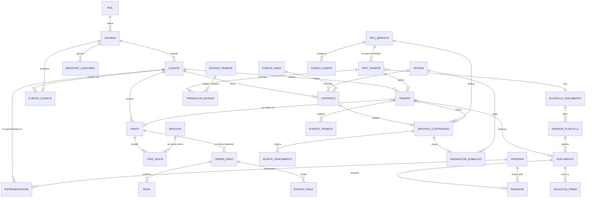

# Modelo de datos

| | |
|---|---|
| **Cliente** | Easy Office |
| **Proyecto** | CRM Easy Office · Plataforma de gestión y automatización documental |
| **Documento** | MOD-001 · Modelo de datos |
| **Versión** | 1.3 |
| **Fecha** | 12 de octubre de 2026 |
| **Motor** | PostgreSQL (ver `REC-001` para la justificación) |
| **Estado** | Actualizado con la muestra de 34 campos, las plantillas y las decisiones de la reunión del 08-10-2026 (`ACTA-002`). Pendientes en la sección 7 |
| **Preparado por** | Fernando Cartagena · Nicolás Zapata · Marcos Álvarez |

---

## 1. Alcance del modelo

Cubre las ocho áreas que define el encargo: usuarios y permisos, ficha del
cliente, servicios contratados con sus vencimientos, oficinas para el servicio
piloto, trámites configurables, documentos con sus plantillas y firmantes, pagos,
y auditoría.

Easy Office estima **alrededor de 30 campos por cliente** entre antecedentes,
contacto, servicios contratados y características de esos servicios (§4.1). El
modelo los distribuye entre `Cliente`, `Persona` y `ServicioContratado` en lugar
de concentrarlos en una sola tabla ancha, porque los datos de servicio son de
cardinalidad múltiple: un cliente puede tener varios servicios (§4.7).

---

## 2. Diagrama entidad-relación

---

## 3. Entidades

### 3.1 Usuarios y permisos

Responde al §4.2 del encargo, que define dos perfiles con facultades distintas y
recomienda un modelo por roles para poder crear perfiles nuevos sin reconstruir
el sistema.

| Entidad | Campos principales | Notas |
|---|---|---|
| `ROL` | `nombre`, `descripcion`, `permisos` | Solo existen dos roles: Administrador y Ejecutivo (`ACTA-002`). El modelo conserva la posibilidad de crear otros como datos (§4.2) |
| `USUARIO` | `email` (identificador de acceso), `nombres`, `apellidos`, `rol`, `activo`, `ultimo_acceso` | Personal de Easy Office. Acceso individual con usuario y contraseña (§4.3) |
| `CUENTA_CLIENTE` | `usuario` (uno a uno con `USUARIO`), `cliente`, `activa` | Cuenta del cliente en el portal (RF-45). Reutiliza la sesión y la contraseña de `USUARIO`, pero **sin rol, sin grupo y sin acceso al backoffice**: los permisos del personal nunca le aplican. Un cliente puede tener más de una cuenta. Al registrarse, un RUT ya existente solo se vincula si el correo coincide y el cliente aún no tiene cuenta; cualquier otro rechazo devuelve el mismo error genérico, para no revelar qué RUT están registrados. **Implementada** |

**Regla derivada del §4.2:** el rol Ejecutivo no tiene la facultad de eliminar
registros de clientes. La restricción se expresa como permiso del rol, no como
condición en el código.

### 3.2 Clientes

| Entidad | Campos principales | Notas |
|---|---|---|
| `CLIENTE` | `codigo` (identificador interno único, §4.5), `tipo` (natural / jurídica), `rut`, `nombre_razon_social`, `giro`, `email`, `telefono`, `direccion`, `comuna`, `region`, `ejecutivo_responsable`, `estado`, `observaciones` | Búsqueda indexada por RUT, razón social, teléfono, correo y folio de sus contratos (§4.5). En la planilla: RAZON SOCIAL, R.U.T., GIRO PRINCIPAL, MAIL, CELULAR 8 DIGITOS |
| `PERSONA` | `rut`, `nombres`, `apellido_paterno`, `apellido_materno`, `nacionalidad`, `estado_civil`, `profesion`, `domicilio`, `comuna`, `region`, `email`, `telefono` | Personas naturales que intervienen: representantes legales, firmantes y autorizantes. Los contratos exigen nacionalidad, estado civil, profesión y domicilio |
| `REPRESENTACION` | `cliente`, `persona`, `cargo`, `fecha_escritura_estatuto`, `registro_o_notaria`, `vigencia_desde`, `vigencia_hasta` | Un contrato lo firma el representante legal de la empresa, no "el cliente". La vigencia importa: no puede firmar quien ya no representa |

`CLIENTE` y `PERSONA` están separadas porque una misma persona puede ser
representante de varias empresas y firmante de documentos donde no es el cliente.

### 3.3 Servicios

Responde a los §4.6, §4.7 y §4.8.

| Entidad | Campos principales | Notas |
|---|---|---|
| `TIPO_SERVICIO` | `nombre`, `descripcion`, `precio_base`, `duracion_meses`, `es_automatizable`, `requiere_pago`, `requiere_firma`, `activo` | `es_automatizable` distingue los procesos automatizados de los asistidos |
| `CONTRATO` | `folio` (único), `cliente`, `oficina`, `cuenta_pago`, `fecha_inicio`, `duracion_meses`, `fecha_vencimiento`, `estado`, `ejecutivo_responsable` | Agrupa los servicios contratados en un mismo acto. Equivale a una fila de la planilla actual. Folio según RN-38; vencimiento calculado según RN-37 |
| `SERVICIO_CONTRATADO` | `contrato`, `cliente`, `tipo_servicio`, `fecha_inicio`, `fecha_termino`, `ciclo_pago`, `estado`, `precio`, `ejecutivo_responsable`, `caracteristicas` (JSONB), `observaciones` | El precio se guarda en la contratación, no solo en el tipo: puede diferir del precio base y el dashboard pide ventas por servicio y por ejecutivo (§4.9) |
| `CONFIG_ALERTA` | `tipo_servicio`, `dias_anticipacion` | Anticipación configurable. Valores iniciales: 60, 30, 15 y 7 días (§4.8) |
| `ALERTA_VENCIMIENTO` | `servicio_contratado`, `dias_anticipacion`, `fecha_programada`, `estado`, `canal`, `enviada_en` | `canal` queda preparado para correo o mensajería, que el §4.8 menciona como extensión futura |

Las alertas se materializan como filas, no se calculan al vuelo, para que quede
registro de cuáles se generaron y cuáles se gestionaron.

### 3.4 Inmuebles

El servicio piloto es el domicilio tributario, cuyo contrato contiene la
ubicación de la oficina y su rol de avalúo.

| Entidad | Campos principales | Notas |
|---|---|---|
| `OFICINA` | `codigo` (`LF`, `VL`, `SA`), `tipo` (oficina / bodega), `direccion`, `comuna`, `region`, `rol_avaluo`, `unidad_sii`, `autorizante_razon_social`, `autorizante_rut`, `autorizante_representante` (`PERSONA`), `capacidad_domicilios`, `activa` | El código de sucursal forma parte del folio. El autorizante es el propietario del inmueble que firma la autorización de domicilio (RN-43) |
| `ASIGNACION_DOMICILIO` | `oficina`, `servicio_contratado`, `vigencia_desde`, `vigencia_hasta` | Permite saber cuántas empresas están domiciliadas en una oficina y controlar el cupo |

`capacidad_domicilios` está `[PENDIENTE DE VALIDAR CON EASY OFFICE]`: no se
confirmó si existe un límite por oficina.

### 3.4 bis Configuración de la empresa

| Entidad | Campos principales | Notas |
|---|---|---|
| `CONFIG_EMPRESA` | `razon_social`, `rut`, `representante` (`PERSONA`), `fecha_personeria`, `registro_personeria`, `correo_contacto`, `correo_pagos`, `telefono` | Datos de Easy Office que aparecen en los contratos. Easy Office e Inoffice son la misma empresa (`ACTA-002`) |
| `CUENTA_PAGO` | `banco`, `tipo_cuenta`, `numero`, `titular`, `texto_contrato`, `activa` | Las cuentas que hoy se escriben en el campo BANCO/LINK del contrato |

Estos datos estaban escritos directamente en las plantillas. Al llevarlos a
configuración, un cambio de representante o de cuenta no obliga a editar cada
plantilla.

### 3.5 Trámites y motor configurable

Responde al §5.2 (formularios que se adaptan a distintos servicios sin desarrollo
nuevo) y al §8.2 (incorporar tipos de documentos de forma modular).

| Entidad | Campos principales | Notas |
|---|---|---|
| `TIPO_TRAMITE` | `nombre`, `tipo_servicio`, `plantilla`, `configuracion` (JSONB: campos, validaciones, orden), `requiere_pago`, `requiere_firma`, `activo`, `version` | El corazón del motor. Un tipo de trámite se define como dato |
| `ESTADO_TRAMITE` | `codigo`, `nombre`, `es_final` | Valores iniciales según RN-42: Iniciado, Pendiente, Completado |
| `MOTIVO_PENDIENTE` | `codigo`, `nombre`, `aplica_a` (trámite / documento), `activo` | Catálogo de motivos por los que un trámite o documento queda Pendiente (RF-47). Lista inicial propuesta: falta información, revisión del borrador, pago, firma `[PENDIENTE DE VALIDAR CON EASY OFFICE]` |
| `TRANSICION_ESTADO` | `tipo_tramite`, `estado_origen`, `estado_destino`, `rol_autorizado`, `condicion` | La máquina de estados es una tabla, no condicionales repartidos por el código |
| `TRAMITE` | `folio`, `cliente`, `tipo_tramite`, `servicio_contratado`, `estado_actual`, `motivo_pendiente`, `canal_origen` (portal / backoffice), `ejecutivo`, `datos` (JSONB), `creado_en` | `canal_origen` permite medir cuántos trámites se completan sin intervención de un ejecutivo |
| `EVENTO_TRAMITE` | `tramite`, `estado_anterior`, `estado_nuevo`, `usuario`, `fecha`, `observacion` | Línea de tiempo del trámite |

La `configuracion` en JSONB guarda la definición del formulario. PostgreSQL
permite indexar y consultar dentro de ese campo, de modo que no se pierde
capacidad de consulta al usarlo.

### 3.6 Documentos

| Entidad | Campos principales | Notas |
|---|---|---|
| `PLANTILLA_DOCUMENTO` | `nombre`, `tipo_documento`, `activa` | Easy Office ya tiene formatos definidos (§6) |
| `VERSION_PLANTILLA` | `plantilla`, `numero_version`, `archivo`, `campos_requeridos` (JSONB), `vigente_desde`, `creada_por` | Inmutable una vez emitido un documento con ella |
| `DOCUMENTO` | `tramite`, `version_plantilla`, `archivo_generado`, `hash_generado`, `archivo_firmado`, `hash_firmado`, `datos_snapshot` (JSONB), `estado`, `generado_en` | Un trámite puede producir más de un documento: por ejemplo contrato y autorización, o una regeneración tras corregir datos. Ver decisiones 1 a 3 |
| `FIRMANTE` | `documento`, `persona`, `rol_firmante`, `orden`, `estado`, `firmado_en` | Un documento puede requerir más de una firma |
| `SOLICITUD_FIRMA` | `documento`, `proveedor`, `id_externo`, `estado`, `enviada_en`, `respuesta` (JSONB) | `id_externo` único para idempotencia |

### 3.7 Ventas y pagos

Implementado en el módulo `ventas` (ver `ARQ-001 §4.4`). Una **venta** es lo que el
cliente compra; una **orden de pago** es un intento de cobrarla ante un proveedor;
un **pago** es la transacción que el proveedor confirmó. Separarlos permite
reintentar con otro medio sin duplicar la venta (RN-28).

| Entidad | Campos principales | Notas |
|---|---|---|
| `SERVICIO` | `codigo` (único), `nombre`, `descripcion`, `precio_base` (CLP), `precio_confirmado`, `activo` | Catálogo vendible, editable desde el panel de administración. `precio_confirmado` es falso mientras Easy Office no valide el valor: el portal rotula esos precios como «Valores de ejemplo». Es distinto de `TIPO_SERVICIO` (§3.3): aquel describe cómo se opera un servicio; este, cómo se vende. La relación entre ambos queda pendiente (MD-10) |
| `VENTA` | `folio` (VEN-000001), `cliente`, `estado`, `total`, `pagada_en` | Estados: pendiente de pago, pagada, reembolsada, anulada. Su estado solo cambia mediante el servicio de dominio de `ventas`, nunca por escritura directa |
| `ITEM_VENTA` | `venta`, `servicio`, `nombre`, `precio_unitario`, `cantidad`, `subtotal` | Nombre y precio se **copian al comprar** (RN-08): un cambio posterior del catálogo no altera ventas ya hechas. El precio sale siempre del servidor, nunca de la petición del cliente |
| `ORDEN_PAGO` | `venta`, `proveedor`, `referencia` (UUID único, es lo que ve el proveedor), `id_externo` (único, nulo hasta que el proveedor responde), `monto`, `estado`, `redirect_url`, `detalle_error`, `sincronizada_en` | Un intento de cobro (RN-28). Estados: creando, pendiente, pagada, rechazada, expirada, cancelada, reembolsada, error. Solo hay transiciones hacia adelante; el dinero recibido prevalece sobre un rechazo anterior y un monto distinto del esperado deja la orden en error |
| `PAGO` | `orden`, `tipo`, `id_externo` (con índice, no único), `monto`, `medio`, `marca`, `tipo_tarjeta`, `ultimos_digitos`, `cuotas`, `billetera`, `pagado_en`, `respuesta` (JSONB) | Transacción confirmada. Restricción: un solo pago de tipo venta por orden. `id_externo` no es único porque el ambiente de pruebas de Klap repite el mismo identificador de comercio en todos los pagos |
| `EVENTO_PAGO` | `orden`, `proveedor`, `evento`, `clave_dedup` (único), `payload` (JSONB), `resultado` | Registro de notificaciones, solo inserción. Resultado: procesado, ignorado, firma inválida o rechazado. `clave_dedup` hace idempotente la recepción: una notificación repetida recibe la misma respuesta que la primera |

**Vínculo con el trámite.** Hoy la venta se asocia al cliente, pero todavía no al
trámite ni al contrato, ni tiene ejecutivo responsable. Ese vínculo es parte del
flujo de punta a punta del domicilio tributario (MD-10); mientras tanto, las
ventas del dashboard se muestran como datos de ejemplo. La modalidad 50/50 que
Easy Office usa hoy por transferencia no está modelada.

### 3.8 Auditoría

Responde literalmente al §4.3, que enumera los campos que debe registrar cada
modificación importante.

| Entidad | Campos principales |
|---|---|
| `REGISTRO_AUDITORIA` | `usuario`, `accion`, `entidad`, `registro_id`, `valor_anterior` (JSONB), `valor_nuevo` (JSONB), `fecha_hora`, `direccion_ip` |

El encargo exige que el historial esté protegido para impedir que usuarios
normales lo alteren o eliminen. Se implementa como tabla **append-only**: sin
operaciones de actualización ni borrado, y con la escritura mediante disparadores
de base de datos en lugar de señales de la aplicación, porque un disparador es
más difícil de eludir y más fácil de demostrar ante una auditoría.

---

## 4. Decisiones de diseño

**1 · Plantillas versionadas.** Cada documento emitido apunta a la versión exacta
de plantilla con que se generó. Si Easy Office corrige una cláusula, los
documentos emitidos antes no cambian. Sin esto, un contrato firmado en marzo
podría "reescribirse" al editar la plantilla en mayo.

**2 · Copia congelada de los datos.** `DOCUMENTO.datos_snapshot` guarda los datos
usados al generar. Si el cliente actualiza su dirección después, el contrato
firmado conserva la que tenía al firmar. Es la diferencia entre un sistema
documental y un generador de plantillas.

**3 · Hash de integridad.** Se calcula y almacena por separado para el archivo
generado y para el archivo firmado.

Importante: **los dos hashes son necesariamente distintos**. La firma electrónica
se incorpora dentro del PDF, que admite actualizaciones incrementales, de modo
que el archivo firmado no es byte a byte igual al generado. Comparar ambos hashes
esperando igualdad sería un control que falla siempre.

Lo que cada hash permite verificar:

- `hash_generado` prueba qué archivo exacto se envió al proveedor de firma, y
  permite detectar cualquier alteración del documento entre su generación y su
  envío.
- `hash_firmado` prueba qué archivo exacto se recibió de vuelta, y permite
  detectar alteraciones posteriores al archivo almacenado.
- La correspondencia entre ambos se establece por el identificador de la
  solicitud de firma (`SOLICITUD_FIRMA.id_externo`), no por comparación de
  hashes, y se complementa con la validación de la firma del documento recibido.

**4 · Máquina de estados como datos.** Las transiciones válidas viven en
`TRANSICION_ESTADO`, con el rol autorizado para cada una. Agregar un estado a un
servicio nuevo no requiere tocar código.

**5 · Idempotencia en operaciones externas.** `EVENTO_PAGO` lleva una clave de
deduplicación única y `SOLICITUD_FIRMA` un identificador externo único; ambos
registran cada evento recibido.

**6 · JSONB donde la forma es variable.** `TIPO_TRAMITE.configuracion`,
`TRAMITE.datos`, `SERVICIO_CONTRATADO.caracteristicas` y los valores de auditoría.
El resto es relacional estricto, con claves foráneas e integridad referencial.

**7 · Trámite y servicio contratado son distintos.** El trámite es la operación,
con su flujo y sus estados; el servicio contratado es lo que el cliente tiene
vigente, con su fecha de vencimiento. Un trámite de renovación crea un servicio
contratado nuevo sin borrar el anterior, lo que preserva el historial que pide
el §4.6.

**8 · El folio pertenece al contrato.** La planilla de Easy Office genera un folio
nuevo en cada ingreso y el contrato se titula con él, de modo que el folio
identifica el contrato y no al cliente. Un cliente que renueva o contrata otro
servicio conserva su registro y recibe un contrato con folio nuevo. El
correlativo se asigna dentro de una transacción con bloqueo para que dos
contratos simultáneos no reciban el mismo número.

---

## 5. Índices previstos

Derivados de los criterios de búsqueda del §4.5 y de los indicadores del §4.9.

| Tabla | Índice | Motivo |
|---|---|---|
| `CLIENTE` | `rut` (único), `codigo` (único) | Identificación |
| `CONTRATO` | `folio` (único), `fecha_vencimiento` | Búsqueda por folio y vencimientos |
| `CLIENTE` | `nombre_razon_social`, `email`, `telefono` | Búsqueda declarada |
| `CLIENTE` | `ejecutivo_responsable`, `estado` | Filtros del listado |
| `SERVICIO_CONTRATADO` | `fecha_termino`, `estado` | Detección de vencimientos |
| `SERVICIO_CONTRATADO` | `tipo_servicio`, `ejecutivo_responsable` | Ventas por servicio y por ejecutivo |
| `TRAMITE` | `folio` (único), `estado_actual`, `creado_en` | Listados y dashboard |
| `REGISTRO_AUDITORIA` | `entidad` + `registro_id`, `fecha_hora` | Consulta del historial de un registro |

---

## 6. Migración desde Excel

Easy Office entregó el formulario de Excel con macros y una muestra de la base
de datos con 34 columnas (`ACTA-002`). Cada fila de la planilla corresponde a un
contrato y se distribuye así: `CONTRATO` (folio, fechas, duración, sucursal,
cuenta), hasta tres `SERVICIO_CONTRATADO` (servicio, precio, ciclo), `CLIENTE`
(razón social, RUT, giro, correo, celular), `PERSONA` y `REPRESENTACION`
(representante legal, su domicilio y la fecha de la personería). El diccionario
completo está en `13_plantillas/README.md`.

Dos reglas propias de la migración:

- El vencimiento se **recalcula** con RN-37 y las diferencias con el valor
  digitado se informan en el reporte, sin corregirlas en silencio.
- Los folios históricos se conservan tal como están, aunque usen el formato
  anterior de dos dígitos `[PENDIENTE DE VALIDAR CON EASY OFFICE]`.

El proceso previsto:

1. **Perfilado.** Inventario de columnas, tipos reales, valores nulos, duplicados
   y formatos inconsistentes.
2. **Mapeo.** Tabla de correspondencia entre cada columna y su campo destino, con
   las transformaciones necesarias.
3. **Carga en etapas.** Tabla de staging sin restricciones, validación, y recién
   entonces carga a las tablas definitivas.
4. **Cuarentena.** Los registros que no pasan validación no se cargan a medias:
   quedan apartados con el motivo.
5. **Reporte.** Salida con registros cargados, en cuarentena y el motivo de cada
   rechazo, para que Easy Office corrija en origen.
6. **Repetible.** El proceso puede ejecutarse varias veces sin duplicar registros.

La planilla contiene datos personales reales. Se anonimiza antes de entrar a
cualquier entorno de desarrollo y ningún dato real se versiona en el repositorio,
que es público.

---

## 7. Pendientes de validación

| # | Pendiente | Impacto |
|---|---|---|
| MD-01 | ~~Listado definitivo de los campos del cliente~~ | Cerrado: muestra de 34 campos recibida el 08-10-2026 |
| MD-02 | Listado de servicios y sus características | Define `TIPO_SERVICIO` y el contenido de `caracteristicas` |
| MD-03 | Motivos de pendiente y transiciones válidas | Estados confirmados el 12-10-2026 (Iniciado, Pendiente, Completado); falta la lista cerrada de motivos (TA-13) |
| MD-04 | Si existe límite de empresas domiciliadas por oficina | Define `capacidad_domicilios` |
| MD-05 | ~~Formato de las plantillas de contrato~~ | Cerrado: Word con campos de combinación (`13_plantillas`) |
| MD-06 | Si los precios son fijos por servicio o varían por cliente | Ya está previsto guardarlos en la contratación |
| MD-07 | Campos variables de cada documento a automatizar | Definidos para PLT-01 y PLT-02; pendientes PLT-03 a PLT-05 y el poder simple |
| MD-08 | ~~Regla exacta del vencimiento~~ | Cerrado 12-10-2026: inicio + duración − 1 día (RN-37) |
| MD-09 | Formato vigente del folio y tratamiento de los folios históricos | Migración e índice único de `CONTRATO.folio` |
| MD-10 | Vínculo de `VENTA` con `TRAMITE` y `CONTRATO`, ejecutivo de la venta y relación entre `SERVICIO` y `TIPO_SERVICIO` | Cierra el flujo del piloto y habilita las ventas reales del dashboard |
| MD-11 | Política de reembolsos | El adaptador de Klap soporta el reembolso; el de Flow no, y no existe operación de reembolso en la aplicación |
| MD-12 | Precios definitivos de los servicios | Los valores cargados son de ejemplo y no coinciden con los de los contratos vigentes (§3.7) |

---

## Historial de versiones

| Versión | Fecha | Cambios |
|---|---|---|
| 1.0 | 24-09-2026 | Modelo inicial |
| 1.1 | 09-10-2026 | Entidades `CONTRATO`, `CUENTA_CLIENTE`, `CONFIG_EMPRESA` y `CUENTA_PAGO`; el folio pasa del cliente al contrato; atributos de oficina (código, autorizante, unidad del SII) y de persona requeridos por los contratos; estados iniciales; mapeo de la planilla de 34 columnas; pendientes MD-01 y MD-05 cerrados |
| 1.2 | 12-10-2026 | Estados Iniciado, Pendiente y Completado; catálogo `MOTIVO_PENDIENTE` y campo `TRAMITE.motivo_pendiente` (RF-47); MD-08 cerrado |
| 1.3 | 12-10-2026 | Modelo implementado de cuentas de cliente (`CUENTA_CLIENTE` ligada a `USUARIO`) y de ventas y pagos (`SERVICIO`, `VENTA`, `ITEM_VENTA`, `ORDEN_PAGO`, `PAGO`, `EVENTO_PAGO`); pendientes MD-10 a MD-12 |
